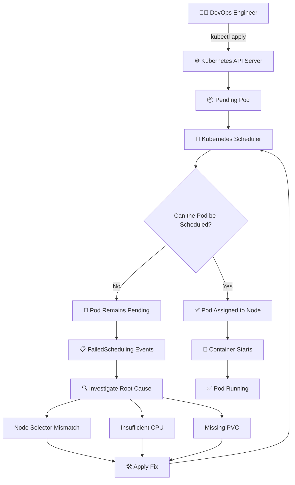
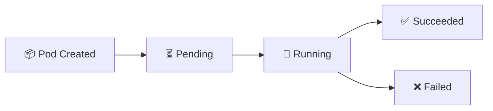
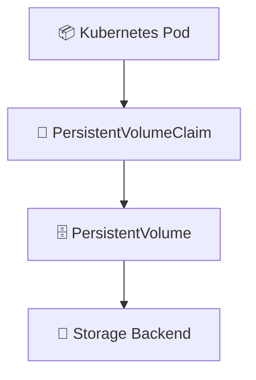
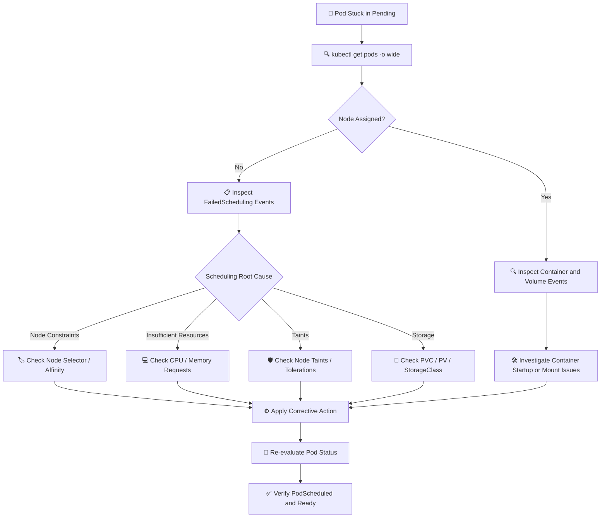

# ☸️ Kubernetes Pod Stuck in Pending State — Hands-On Troubleshooting Lab

**Vyomanant Academy | Kubernetes Production Troubleshooting Series**

Learn how to diagnose and resolve Kubernetes Pods stuck in the `Pending` state using real-world scheduling, resource allocation, and storage troubleshooting scenarios.

| Lab Information | Details |
|---|---|
| 🎯 Skill Level | Beginner to Intermediate |
| ⏱️ Estimated Duration | 45–60 Minutes |
| 🛠️ Technologies | Kubernetes, kubectl, Linux |
| 🧪 Lab Environment | Minikube, Kind, or Kubernetes Cluster |
| 🏢 Lab Type | Instructor-Led + Self-Paced |
| 📚 Category | Kubernetes Troubleshooting |
| 🔢 Lab Number | 0001 |

---

# 🌍 Lab Overview

In Kubernetes, a Pod can remain in the `Pending` state when it cannot proceed to the container-running stage.

A common reason is that the Kubernetes scheduler cannot find a suitable node to run the Pod.

Other causes include unresolved storage requirements, scheduling constraints, or delays while preparing containers.

### 🔍 Common Causes of Pending Pods

- ❌ Insufficient CPU resources
- ❌ Insufficient memory resources
- ❌ Node selector mismatch
- ❌ Node affinity restrictions
- ❌ Untolerated node taints
- ❌ Unavailable PersistentVolumeClaims
- ❌ Nodes being unavailable or unschedulable

### 🧪 What Will You Troubleshoot?

In this lab, you will intentionally create three Kubernetes scheduling problems.

| Scenario | Problem | Troubleshooting Skill |
|---|---|---|
| 🔴 Scenario 1 | Node selector mismatch | Diagnose scheduling constraints |
| 🔴 Scenario 2 | Insufficient CPU resources | Investigate resource requests |
| 🔴 Scenario 3 | Missing PersistentVolumeClaim | Troubleshoot storage dependencies |

For each scenario, you will:

1. Deploy a broken Pod.
2. Observe the Pending state.
3. Investigate Pod events.
4. Identify the root cause.
5. Apply a corrective action.
6. Verify successful Pod scheduling.

> ⚠️ **Important:** Perform these exercises in a dedicated Kubernetes training environment. Some examples intentionally create unschedulable workloads.

---

# 🎯 Learning Objectives

After completing this lab, you will be able to:

- ✅ Understand the Kubernetes Pod lifecycle.
- ✅ Explain the meaning of the Pending state.
- ✅ Understand how the Kubernetes scheduler selects nodes.
- ✅ Identify Pods that cannot be scheduled.
- ✅ Troubleshoot node selector mismatches.
- ✅ Investigate CPU resource scheduling failures.
- ✅ Diagnose storage-related Pending Pods.
- ✅ Use kubectl to inspect Pod events and scheduling conditions.
- ✅ Apply corrections to Kubernetes manifests.
- ✅ Verify successful Pod scheduling and recovery.

---

# 🧰 Prerequisites

Ensure the following prerequisites are available.

| Requirement | Description |
|---|---|
| Kubernetes Cluster | Minikube, Kind, or managed Kubernetes |
| kubectl CLI | Installed and configured |
| Cluster Permissions | Create Pods and namespaces |
| Linux Terminal | Bash-compatible environment |
| YAML Knowledge | Basic Kubernetes manifests |
| Container Image Access | Ability to pull BusyBox images |

> 💡 A small, single-node Minikube or Kind cluster is sufficient for this lab.

# Step 1 — Verify Kubernetes Connectivity

```bash
kubectl cluster-info
```

Expected: The Kubernetes control plane endpoint is displayed.

# Step 2 — Check Kubernetes Nodes

```bash
kubectl get nodes
```

Example:

```text
NAME           STATUS   ROLES           AGE   VERSION
minikube       Ready    control-plane   5d    v1.xx.x
```

Your node names and Kubernetes versions will differ.

# Step 3 — Create a Dedicated Namespace

```bash
kubectl create namespace pending-lab
```

# Step 4 — Set the Default Namespace

```bash
kubectl config set-context --current --namespace=pending-lab
```

> ⚠️ This updates the namespace in your current kubectl context. Confirm that you are using your training cluster.

# Step 5 — Verify the Namespace

```bash
kubectl get pods
```

Expected:

```text
No resources found in pending-lab namespace.
```

✅ **Lab Environment Ready**

---

# 🏗️ Lab Architecture



### 🧠 How Kubernetes Scheduling Works

When a new Pod is created:

1. The Kubernetes API server accepts the Pod definition.
2. The Pod initially enters the Pending phase.
3. The Kubernetes scheduler evaluates eligible nodes.
4. The scheduler checks resource availability and scheduling constraints.
5. If a suitable node is found, the Pod is assigned to that node.
6. The kubelet on the selected node prepares and starts the container.

If scheduling requirements cannot be satisfied, the Pod remains Pending.

### Kubernetes Pod Lifecycle



> 💡 **Important:** Pending is a Pod phase, not necessarily an error. A Pod can temporarily be Pending during normal startup. Check its conditions and events before diagnosing a scheduling failure.

---

# 🚀 Step-by-Step Instructions

# 🔴 Scenario 1 — Pod Pending Due to Node Selector Mismatch

# 🎯 Objective

Understand how an incorrect `nodeSelector` prevents Kubernetes from scheduling a Pod.

# 🧠 Understanding Node Selector

The `nodeSelector` field tells Kubernetes to schedule a Pod only on nodes containing specified labels.

For example:

```yaml
nodeSelector:
  environment: production
```

This Pod can only be scheduled onto a node labeled:

```text
environment=production
```

If no eligible node has that label, the Pod remains Pending.

# Step 1 — Inspect Existing Node Labels

```bash
kubectl get nodes --show-labels
```

Observe the labels assigned to your Kubernetes nodes.

# Step 2 — Create a Pod with an Invalid Node Selector

Create a manifest:

```bash
nano pending-node-selector.yaml
```

Add the following YAML:

```yaml
apiVersion: v1
kind: Pod
metadata:
  name: pending-node-selector
spec:
  nodeSelector:
    environment: non-existent-lab-environment
  containers:
  - name: nginx
    image: nginx:stable
    ports:
    - containerPort: 80
```

### 🧠 Explanation

The Pod requires a node with the label:

```text
environment=non-existent-lab-environment
```

Since the training cluster should not contain this label, Kubernetes cannot find an eligible node.

> ⚠️ Verify that no node already has this exact label. If one does, choose another label value that does not exist.

# Step 3 — Deploy the Pod

```bash
kubectl apply -f pending-node-selector.yaml
```

# Step 4 — Check Pod Status

```bash
kubectl get pods
```

Expected:

```text
NAME                    READY   STATUS    RESTARTS   AGE
pending-node-selector   0/1     Pending   0          15s
```

# Step 5 — Inspect Pod Details

```bash
kubectl describe pod pending-node-selector
```

Look for the Events section.

Example:

```text
Warning  FailedScheduling  default-scheduler
0/1 nodes are available:
1 node(s) didn't match Pod's node affinity/selector.
```

The exact wording and number of nodes depend on your Kubernetes environment.

### 🔍 Root Cause

Kubernetes cannot find a node matching the Pod's required label.

# Step 6 — Check Pod Scheduling Information

```bash
kubectl get pod pending-node-selector -o wide
```

Expected:

```text
NAME                    READY   STATUS    RESTARTS   AGE   IP       NODE
pending-node-selector   0/1     Pending   0          1m    <none>   <none>
```

The `NODE` field is empty because the scheduler has not assigned the Pod to a node.

# Step 7 — Fix the Node Selector

Edit the manifest:

```bash
nano pending-node-selector.yaml
```

Replace the configuration with:

```yaml
apiVersion: v1
kind: Pod
metadata:
  name: pending-node-selector
spec:
  containers:
  - name: nginx
    image: nginx:stable
    ports:
    - containerPort: 80
```

The incorrect `nodeSelector` restriction has been removed.

# Step 8 — Recreate the Pod

For this lab, recreate the standalone Pod to apply the scheduling configuration change.

```bash
kubectl delete pod pending-node-selector
```

```bash
kubectl apply -f pending-node-selector.yaml
```

# Step 9 — Verify Recovery

```bash
kubectl get pods
```

Expected after the image downloads and the container starts:

```text
NAME                    READY   STATUS    RESTARTS   AGE
pending-node-selector   1/1     Running   0          30s
```

Verify node assignment:

```bash
kubectl get pod pending-node-selector -o wide
```

The `NODE` column should now contain a Kubernetes node name.

✅ **Scenario 1 Completed Successfully**

---

# 🔴 Scenario 2 — Pod Pending Due to Insufficient CPU Resources

# 🎯 Objective

Understand how Kubernetes resource requests affect Pod scheduling.

# 🧠 Understanding Resource Requests

Kubernetes uses resource requests when deciding whether a Pod can fit on a node.

Example:

```yaml
resources:
  requests:
    cpu: "500m"
    memory: "128Mi"
```

### Resource Units

| Resource | Meaning |
|---|---|
| `100m` CPU | 0.1 CPU core |
| `500m` CPU | 0.5 CPU core |
| `1000m` CPU | 1 CPU core |
| `128Mi` | 128 mebibytes of memory |
| `1Gi` | 1 gibibyte of memory |

> 💡 Kubernetes scheduling evaluates resource requests against node allocatable capacity and already allocated requests—not simply current CPU or memory utilization.

# Step 1 — Inspect Node Resources

```bash
kubectl get nodes
```

Check node resource information:

```bash
kubectl describe nodes
```

Look for:

```text
Capacity:
  cpu:
  memory:

Allocatable:
  cpu:
  memory:
```

Also examine the `Allocated resources` section.

# Step 2 — Create a Pod Requesting Excessive CPU

Create a manifest:

```bash
nano pending-cpu.yaml
```

Add:

```yaml
apiVersion: v1
kind: Pod
metadata:
  name: pending-cpu
spec:
  containers:
  - name: nginx
    image: nginx:stable
    resources:
      requests:
        cpu: "100000"
        memory: "128Mi"
      limits:
        memory: "256Mi"
```

### 🧠 Explanation

The Pod requests:

```text
CPU: 100000 cores
Memory: 128Mi
```

The CPU request intentionally exceeds the capacity of any typical training cluster.

Kubernetes should therefore be unable to schedule this Pod.

> ⚠️ This is an intentionally unrealistic resource request for troubleshooting. Clusters with admission policies, ResourceQuotas, or LimitRanges may reject this Pod during creation instead. If creation is rejected, review the admission error before continuing.

# Step 3 — Deploy the Pod

```bash
kubectl apply -f pending-cpu.yaml
```

# Step 4 — Check Pod Status

```bash
kubectl get pods
```

Expected:

```text
NAME          READY   STATUS    RESTARTS   AGE
pending-cpu   0/1     Pending   0          20s
```

# Step 5 — Inspect Scheduling Events

```bash
kubectl describe pod pending-cpu
```

Look for an event similar to:

```text
Warning  FailedScheduling  default-scheduler

0/1 nodes are available:
1 Insufficient cpu.
```

### 🔍 Root Cause

The requested CPU exceeds the CPU resources available for Pod scheduling.

# Step 6 — Verify Node Allocatable Resources

```bash
kubectl describe nodes
```

Compare the node's allocatable CPU with the Pod's requested CPU.

Example:

```text
Allocatable:
  cpu: 2
```

Requested CPU:

```text
100000
```

The scheduler cannot place this Pod onto the node.

# Step 7 — Fix the Resource Requests

Edit:

```bash
nano pending-cpu.yaml
```

Replace the manifest with:

```yaml
apiVersion: v1
kind: Pod
metadata:
  name: pending-cpu
spec:
  containers:
  - name: nginx
    image: nginx:stable
    resources:
      requests:
        cpu: "100m"
        memory: "64Mi"
      limits:
        cpu: "500m"
        memory: "256Mi"
```

### 🧠 Explanation

The corrected Pod requests:

| Resource | Request | Limit |
|---|---|---|
| CPU | 100m | 500m |
| Memory | 64Mi | 256Mi |

These values are suitable for many small training clusters, provided sufficient allocatable resources remain.

# Step 8 — Recreate the Pod

```bash
kubectl delete pod pending-cpu
```

```bash
kubectl apply -f pending-cpu.yaml
```

# Step 9 — Verify Recovery

```bash
kubectl get pods
```

Expected:

```text
NAME          READY   STATUS    RESTARTS   AGE
pending-cpu   1/1     Running   0          30s
```

Check detailed Pod information:

```bash
kubectl describe pod pending-cpu
```

Verify that the Pod has been scheduled and its container is running.

✅ **Scenario 2 Completed Successfully**

### 🏢 Production Best Practice

Avoid fixing scheduling problems by blindly increasing node capacity or removing resource controls.

Instead:

- Inspect actual application resource requirements.
- Compare requests against node allocatable capacity.
- Review existing resource allocations.
- Right-size CPU and memory requests.
- Scale node capacity when justified.
- Review ResourceQuota and LimitRange policies where applicable.

---

# 🔴 Scenario 3 — Pod Pending Due to Missing PersistentVolumeClaim

# 🎯 Objective

Understand how a missing storage dependency can prevent a Kubernetes Pod from being scheduled.

# 🧠 Understanding PersistentVolumeClaims

Applications sometimes require persistent storage.

A Kubernetes Pod can request storage through a PersistentVolumeClaim (PVC).

The basic relationship is:



If a Pod references a PVC that does not exist, the storage dependency cannot be resolved.

This can prevent successful Pod scheduling.

# Step 1 — Check Existing PVCs

```bash
kubectl get pvc
```

Expected in a new namespace:

```text
No resources found in pending-lab namespace.
```

# Step 2 — Create a Pod Referencing a Missing PVC

Create a manifest:

```bash
nano pending-storage.yaml
```

Add:

```yaml
apiVersion: v1
kind: Pod
metadata:
  name: pending-storage
spec:
  containers:
  - name: nginx
    image: nginx:stable
    volumeMounts:
    - name: app-storage
      mountPath: /usr/share/nginx/html
  volumes:
  - name: app-storage
    persistentVolumeClaim:
      claimName: missing-pvc
```

### 🧠 Explanation

The Pod requires a PersistentVolumeClaim named:

```text
missing-pvc
```

However, this PVC has not been created.

Kubernetes cannot satisfy the Pod's storage dependency.

# Step 3 — Deploy the Pod

```bash
kubectl apply -f pending-storage.yaml
```

# Step 4 — Check Pod Status

```bash
kubectl get pods
```

Expected:

```text
NAME              READY   STATUS    RESTARTS   AGE
pending-storage   0/1     Pending   0          15s
```

# Step 5 — Inspect Pod Events

```bash
kubectl describe pod pending-storage
```

Look for an event resembling:

```text
Warning  FailedScheduling  default-scheduler
persistentvolumeclaim "missing-pvc" not found
```

Exact event formatting varies by Kubernetes version and scheduler configuration.

# Step 6 — Verify the Missing PVC

```bash
kubectl get pvc
```

Check the specific claim:

```bash
kubectl get pvc missing-pvc
```

Expected:

```text
Error from server (NotFound):
persistentvolumeclaims "missing-pvc" not found
```

### 🔍 Root Cause

The Pod references a PersistentVolumeClaim that does not exist in its namespace.

# Step 7 — Fix the Storage Configuration

There are two typical approaches:

**Option A — Production Approach**

Create the required PersistentVolumeClaim and ensure it can be bound to suitable storage.

**Option B — Training Approach**

Replace the missing PVC with an `emptyDir` volume.

For this lab, use Option B to demonstrate successful recovery without requiring a storage provisioner.

> ⚠️ An `emptyDir` volume is ephemeral. It is not a production replacement for persistent storage when data durability is required.

Edit:

```bash
nano pending-storage.yaml
```

Replace the manifest with:

```yaml
apiVersion: v1
kind: Pod
metadata:
  name: pending-storage
spec:
  containers:
  - name: nginx
    image: nginx:stable
    volumeMounts:
    - name: app-storage
      mountPath: /usr/share/nginx/html
  volumes:
  - name: app-storage
    emptyDir: {}
```

### 🧠 Explanation

The Pod now uses an ephemeral volume managed by Kubernetes.

It no longer depends on the missing PersistentVolumeClaim.

# Step 8 — Recreate the Pod

```bash
kubectl delete pod pending-storage
```

```bash
kubectl apply -f pending-storage.yaml
```

# Step 9 — Verify Recovery

```bash
kubectl get pods
```

Expected:

```text
NAME              READY   STATUS    RESTARTS   AGE
pending-storage   1/1     Running   0          30s
```

Check the assigned node:

```bash
kubectl get pod pending-storage -o wide
```

Expected: The Pod is assigned to a node and reaches Running.

✅ **Scenario 3 Completed Successfully**

### 🏢 Production Considerations

When troubleshooting storage-related Pending Pods:

- Verify the PVC exists in the correct namespace.
- Check PVC status and associated events.
- Confirm the StorageClass is available.
- Check whether dynamic volume provisioning is working.
- Verify storage capacity and topology constraints.
- Review volume binding behavior.
- Confirm the application actually requires persistent storage.

---

# 🔎 Verification

# Step 1 — Check All Lab Pods

```bash
kubectl get pods
```

Expected:

```text
NAME                    READY   STATUS    RESTARTS   AGE
pending-node-selector   1/1     Running   0          5m
pending-cpu             1/1     Running   0          4m
pending-storage         1/1     Running   0          3m
```

> 💡 Exact Pod ages, restart counts, and ordering will depend on your environment.

# Step 2 — Verify Node Assignments

```bash
kubectl get pods -o wide
```

Confirm all three Pods have been assigned to Kubernetes nodes.

# Step 3 — Inspect Kubernetes Events

```bash
kubectl get events --sort-by=.metadata.creationTimestamp
```

Review any remaining warnings.

Older scheduling warnings may remain even after the Pods have been corrected.

# Step 4 — Verify Individual Pod Scheduling Conditions

```bash
kubectl describe pod pending-node-selector
```

```bash
kubectl describe pod pending-cpu
```

```bash
kubectl describe pod pending-storage
```

Look for:

```text
Conditions:
  Type           Status
  PodScheduled   True
```

Confirm each Pod has been scheduled successfully.

# Step 5 — Validate Pod Readiness

```bash
kubectl wait --for=condition=Ready pod/pending-node-selector --timeout=120s
```

```bash
kubectl wait --for=condition=Ready pod/pending-cpu --timeout=120s
```

```bash
kubectl wait --for=condition=Ready pod/pending-storage --timeout=120s
```

Expected:

```text
pod/pending-node-selector condition met
```

Equivalent success messages should appear for the other Pods.

If a timeout occurs, inspect the Pod status and events before proceeding.

✅ **Final Verification Complete**

---

# 🛠️ Kubernetes Pending Pod Troubleshooting Commands

| Command | Purpose |
|---|---|
| `kubectl get pods` | Identify Pending Pods |
| `kubectl get pods -o wide` | Check node assignments |
| `kubectl describe pod <pod-name>` | Inspect scheduling events |
| `kubectl get events` | Review cluster events |
| `kubectl get nodes` | Check node readiness |
| `kubectl describe nodes` | Inspect node capacity and allocations |
| `kubectl get nodes --show-labels` | Review node labels |
| `kubectl get pvc` | Check storage claims |
| `kubectl get storageclass` | Inspect available StorageClasses |
| `kubectl get pod <pod-name> -o yaml` | Inspect full Pod configuration |

---

# 🧭 Production Troubleshooting Workflow



### 🧠 Important Troubleshooting Distinction

Not every Pending Pod has a scheduler problem.

| Observation | Likely Investigation |
|---|---|
| Pending and NODE is empty | Scheduler or scheduling constraints |
| Pending and FailedScheduling events | Resource or placement restrictions |
| Pending and PVC not found | Missing storage dependency |
| Pending with node assigned | Container preparation, image, or volume setup |
| ContainerCreating | Image download, mounts, or container initialization |
| ImagePullBackOff | Container image retrieval failure |

> ⚠️ `ContainerCreating` and `ImagePullBackOff` are displayed container states or waiting reasons, not Kubernetes Pod phases. Inspect the underlying Pod phase and container status for an accurate diagnosis.

---

# 🧹 Cleanup

# Step 1 — Delete the Lab Namespace

The namespace contains all three lab Pods.

```bash
kubectl delete namespace pending-lab
```

This removes the namespace and its namespaced resources.

# Step 2 — Verify Namespace Deletion

```bash
kubectl get namespace pending-lab
```

Expected after deletion completes:

```text
Error from server (NotFound):
namespaces "pending-lab" not found
```

# Step 3 — Restore the Default Namespace

```bash
kubectl config set-context --current --namespace=default
```

# Step 4 — Remove Local YAML Files (Optional)

```bash
rm -f pending-node-selector.yaml pending-cpu.yaml pending-storage.yaml
```

> ⚠️ Delete these files only if they are no longer needed. Preserve them if you plan to maintain the lab in GitHub.

✅ **Cleanup Completed**

---

# 🧠 Key Takeaways

- ✅ Pending is a Kubernetes Pod lifecycle phase.
- ✅ The Kubernetes scheduler selects suitable nodes for Pods.
- ✅ Incorrect node selectors can prevent Pod scheduling.
- ✅ Excessive CPU and memory requests can make Pods unschedulable.
- ✅ Missing PersistentVolumeClaims can block scheduling.
- ✅ Pod events provide critical scheduling diagnostic information.
- ✅ `kubectl describe pod` is one of the most useful troubleshooting commands.
- ✅ `kubectl get pods -o wide` helps identify whether a Pod has been assigned to a node.
- ✅ Always identify the root cause before modifying Kubernetes resources.
- ✅ Production remediation should be applied to the appropriate workload configuration and managed through normal deployment processes.

---

# 🎓 Practical Assessment

Complete these tasks independently.

- [ ] Create a Kubernetes Pod with an invalid node selector.
- [ ] Identify why the Pod cannot be scheduled.
- [ ] Inspect FailedScheduling events.
- [ ] Correct the node selector issue.
- [ ] Create a Pod requesting more CPU than the cluster can provide.
- [ ] Identify the insufficient CPU scheduling error.
- [ ] Correct the CPU resource requests.
- [ ] Create a Pod referencing a missing PVC.
- [ ] Diagnose the storage dependency problem.
- [ ] Apply the appropriate storage correction.
- [ ] Verify all three Pods are Running and Ready.
- [ ] Explain the difference between a Pending Pod and a Pod displaying ContainerCreating.

---

# 📚 Official Documentation

| Resource | Official Documentation |
|---|---|
| Kubernetes Pod Lifecycle | [Kubernetes Docs](https://kubernetes.io/docs/concepts/workloads/pods/pod-lifecycle/) |
| Kubernetes Scheduler | [Kubernetes Docs](https://kubernetes.io/docs/concepts/scheduling-eviction/kube-scheduler/) |
| Assigning Pods to Nodes | [Kubernetes Docs](https://kubernetes.io/docs/concepts/scheduling-eviction/assign-pod-node/) |
| Resource Management for Pods | [Kubernetes Docs](https://kubernetes.io/docs/concepts/configuration/manage-resources-containers/) |
| Persistent Volumes and Claims | [Kubernetes Docs](https://kubernetes.io/docs/concepts/storage/persistent-volumes/) |
| Debugging Running Pods | [Kubernetes Docs](https://kubernetes.io/docs/tasks/debug/debug-application/debug-running-pod/) |
| Kubernetes kubectl Reference | [Kubernetes Docs](https://kubernetes.io/docs/reference/kubectl/) |
| GitHub Mermaid Diagrams | [GitHub Docs](https://docs.github.com/en/get-started/writing-on-github/working-with-advanced-formatting/creating-diagrams) |

---

**🎓 Vyomanant Academy — Learn • Practice • Troubleshoot • Validate**

**✅ Lab 0001 Complete**

**➡️ Next Lab: 0002 — Kubernetes Pod CrashLoopBackOff Troubleshooting**
