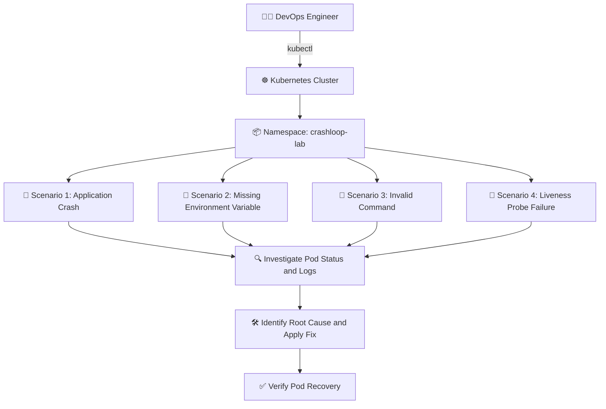
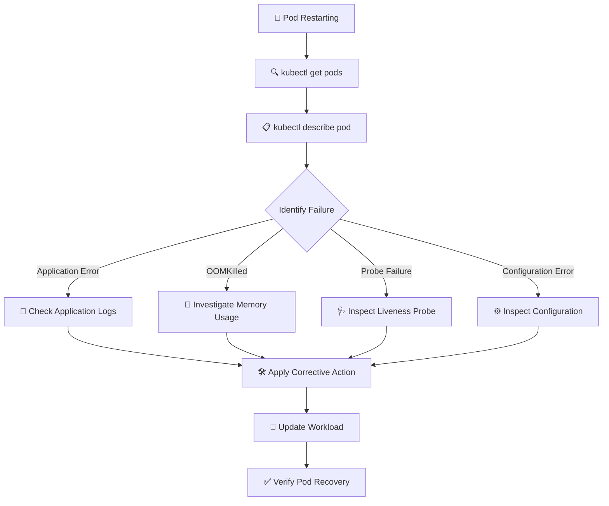

# ☸️ Kubernetes Pod CrashLoopBackOff Troubleshooting — Hands-On Lab

**Vyomanant Academy | Kubernetes Troubleshooting Series**

Learn how to identify, investigate, and resolve Kubernetes Pod CrashLoopBackOff errors using practical troubleshooting scenarios.

| Lab Information | Details |
|---|---|
| 🎯 Skill Level | Beginner to Intermediate |
| ⏱️ Duration | 45–60 Minutes |
| 🛠️ Technologies | Kubernetes, kubectl, Linux |
| 🧪 Environment | Minikube, Kind, or Kubernetes Cluster |
| 🏢 Lab Type | Instructor-Led + Self-Paced |
| 📚 Category | Kubernetes Production Troubleshooting |

---

# 🌍 Lab Overview

In Kubernetes, a Pod may experience `CrashLoopBackOff` when its container repeatedly crashes and Kubernetes attempts to restart it.

This commonly happens because of:

- ❌ Application startup failures
- ❌ Missing environment variables
- ❌ Incorrect container commands
- ❌ Misconfigured liveness probes
- ❌ Insufficient memory or resource limits
- ❌ Application configuration errors

**Important:** `CrashLoopBackOff` is a container waiting reason, not a Kubernetes Pod phase.

In this hands-on lab, you will deliberately deploy broken applications, identify their root causes, fix the issues, and verify successful recovery.

### Troubleshooting Scenarios

| Scenario | Problem | Expected Learning |
|---|---|---|
| 🔴 1 | Application crashes immediately | Diagnose exit codes |
| 🔴 2 | Missing environment variable | Troubleshoot configuration |
| 🔴 3 | Invalid container command | Debug container startup |
| 🔴 4 | Liveness probe failure | Investigate probe restarts |

> ⚠️ **Important:** Perform this lab in a dedicated training cluster. The examples intentionally create failing containers.

---

# 🎯 Learning Objectives

After completing this lab, you will be able to:

- ✅ Understand Kubernetes CrashLoopBackOff behavior.
- ✅ Identify unhealthy Pods and container restart counts.
- ✅ Inspect Pod events and container termination reasons.
- ✅ Retrieve current and previous container logs.
- ✅ Troubleshoot application startup failures.
- ✅ Identify missing environment variables.
- ✅ Resolve invalid container commands.
- ✅ Diagnose liveness probe failures.
- ✅ Apply corrections and verify successful recovery.

---

# 🧰 Prerequisites

Ensure the following requirements are available.

| Requirement | Description |
|---|---|
| Kubernetes Cluster | Minikube, Kind, or remote cluster |
| kubectl | Installed and configured |
| Cluster Access | Permissions to create Pods and namespaces |
| Basic Linux Knowledge | Familiarity with terminal commands |
| YAML Knowledge | Basic Kubernetes manifest understanding |
| Internet Access | For pulling container images |

### Step 1 — Verify Kubernetes Connectivity

```bash
kubectl cluster-info
```

### Step 2 — Verify Cluster Nodes

```bash
kubectl get nodes
```

Expected: At least one node should have the `Ready` status.

### Step 3 — Create a Lab Namespace

```bash
kubectl create namespace crashloop-lab
```

### Step 4 — Set the Default Namespace

```bash
kubectl config set-context --current --namespace=crashloop-lab
```

> ⚠️ This changes the namespace in your current kubectl context. Ensure you are connected to the intended training cluster.

### Step 5 — Verify the Namespace

```bash
kubectl get pods
```

Expected:

```text
No resources found in crashloop-lab namespace.
```

---

# 🏗️ Lab Architecture



### Troubleshooting Workflow

```text
Identify Failing Pod
        |
        v
Inspect Pod Status
        |
        v
Check Pod Events
        |
        v
Analyze Container Logs
        |
        v
Identify Root Cause
        |
        v
Apply Corrective Action
        |
        v
Verify Pod Recovery
```

---

# 🚀 Step-by-Step Instructions

# 🔴 Scenario 1 — Application Crashes Immediately

### 🎯 Objective

Understand how an application exiting with a nonzero exit code causes repeated container restarts.

### Step 1 — Create a Broken Application Pod

Create the manifest:

```bash
nano crash-app.yaml
```

Add the following YAML:

```yaml
apiVersion: v1
kind: Pod
metadata:
  name: crash-app
spec:
  restartPolicy: Always
  containers:
  - name: crash-container
    image: busybox:1.36
    command: ["/bin/sh", "-c"]
    args:
      - echo "Starting application";
        sleep 5;
        echo "Application crashed";
        exit 1
```

### 🧠 Explanation

The container performs four actions:

1. Starts the container.
2. Prints an application startup message.
3. Waits for five seconds.
4. Exits with status code `1`.

Because `restartPolicy` is configured as `Always`, Kubernetes repeatedly attempts to restart the container.

> 💡 `restartPolicy` is defined at the Pod specification level, not inside the container definition.

### Step 2 — Deploy the Pod

```bash
kubectl apply -f crash-app.yaml
```

### Step 3 — Check Pod Status

```bash
kubectl get pods
```

After multiple failures, expected output resembles:

```text
NAME        READY   STATUS             RESTARTS   AGE
crash-app   0/1     CrashLoopBackOff   3          1m
```

> ℹ️ The status might initially display `Running` or `Error`. Wait for repeated restarts.

### Step 4 — Inspect Pod Details

```bash
kubectl describe pod crash-app
```

Look for:

```text
State:          Waiting
  Reason:       CrashLoopBackOff

Last State:     Terminated
  Reason:       Error
  Exit Code:    1
```

Also check the Events section for:

```text
Back-off restarting failed container
```

### Step 5 — Check Container Logs

```bash
kubectl logs crash-app
```

Expected:

```text
Starting application
Application crashed
```

### Step 6 — Retrieve Previous Container Logs

```bash
kubectl logs crash-app --previous
```

This command retrieves logs from the previous terminated container instance.

**Why is this useful?**

In CrashLoopBackOff scenarios, containers may terminate before engineers can inspect the current instance.

Using `--previous` helps retrieve diagnostic information from an earlier attempt.

### Step 7 — Identify the Root Cause

The application explicitly terminates using:

```bash
exit 1
```

| Observation | Meaning |
|---|---|
| Exit Code 1 | Application terminated unsuccessfully |
| Increasing RESTARTS | Kubernetes repeatedly restarts the container |
| CrashLoopBackOff | Kubernetes applies a restart backoff |
| Application crashed | The startup command intentionally fails |

### Step 8 — Fix the Application

Edit:

```bash
nano crash-app.yaml
```

Replace the manifest with:

```yaml
apiVersion: v1
kind: Pod
metadata:
  name: crash-app
spec:
  restartPolicy: Always
  containers:
  - name: crash-container
    image: busybox:1.36
    command: ["/bin/sh", "-c"]
    args:
      - echo "Application started successfully";
        sleep 3600
```

### Step 9 — Recreate the Pod

The container startup command cannot be modified in place for this standalone Pod.

Delete the existing Pod:

```bash
kubectl delete pod crash-app
```

Recreate it:

```bash
kubectl apply -f crash-app.yaml
```

### Step 10 — Verify Recovery

```bash
kubectl get pods
```

Expected:

```text
NAME        READY   STATUS    RESTARTS   AGE
crash-app   1/1     Running   0          10s
```

Check logs:

```bash
kubectl logs crash-app
```

Expected:

```text
Application started successfully
```

✅ **Scenario 1 Completed Successfully**

> 💡 `sleep 3600` keeps the container running for approximately one hour. This is suitable for the lab demonstration but not a real production application health check.

---

# 🔴 Scenario 2 — Missing Environment Variable

### 🎯 Objective

Understand how missing application configuration can cause container startup failures.

### Step 1 — Create a Broken Pod

```bash
nano missing-env.yaml
```

Add:

```yaml
apiVersion: v1
kind: Pod
metadata:
  name: missing-env
spec:
  containers:
  - name: app
    image: busybox:1.36
    command: ["/bin/sh", "-c"]
    args:
      - |
        echo "Checking application configuration..."
        if [ -z "$APP_ENV" ]; then
          echo "ERROR: APP_ENV environment variable is missing"
          exit 1
        fi
        echo "Application started in $APP_ENV mode"
        sleep 3600
```

### 🧠 Explanation

The application requires an environment variable named `APP_ENV`.

If the variable is missing, the startup script terminates with exit code `1`.

### Step 2 — Deploy the Pod

```bash
kubectl apply -f missing-env.yaml
```

### Step 3 — Check Pod Status

```bash
kubectl get pods
```

### Step 4 — Inspect Logs

```bash
kubectl logs missing-env
```

Expected:

```text
Checking application configuration...
ERROR: APP_ENV environment variable is missing
```

### Step 5 — Fix the Environment Variable

Edit:

```bash
nano missing-env.yaml
```

Replace with:

```yaml
apiVersion: v1
kind: Pod
metadata:
  name: missing-env
spec:
  containers:
  - name: app
    image: busybox:1.36
    env:
    - name: APP_ENV
      value: "production"
    command: ["/bin/sh", "-c"]
    args:
      - |
        echo "Checking application configuration..."
        if [ -z "$APP_ENV" ]; then
          echo "ERROR: APP_ENV environment variable is missing"
          exit 1
        fi
        echo "Application started in $APP_ENV mode"
        sleep 3600
```

### Step 6 — Recreate the Pod

```bash
kubectl delete pod missing-env
```

```bash
kubectl apply -f missing-env.yaml
```

### Step 7 — Verify Recovery

```bash
kubectl get pod missing-env
```

Check logs:

```bash
kubectl logs missing-env
```

Expected:

```text
Checking application configuration...
Application started in production mode
```

✅ **Scenario 2 Completed Successfully**

> 🔐 **Production Best Practice:** Store sensitive application values in Kubernetes Secrets instead of hardcoding credentials inside manifests.

---

# 🔴 Scenario 3 — Invalid Container Command

### 🎯 Objective

Identify container startup failures caused by invalid commands or missing executables.

### Step 1 — Create a Broken Pod

```bash
nano invalid-command.yaml
```

Add:

```yaml
apiVersion: v1
kind: Pod
metadata:
  name: invalid-command
spec:
  containers:
  - name: app
    image: busybox:1.36
    command: ["/bin/sh", "-c"]
    args:
      - |
        echo "Starting application"
        /app/nonexistent-binary
```

### 🧠 Explanation

The container attempts to execute:

```bash
/app/nonexistent-binary
```

However, this executable does not exist inside the container image.

The shell reports a command-not-found error and terminates.

### Step 2 — Deploy the Pod

```bash
kubectl apply -f invalid-command.yaml
```

### Step 3 — Check Logs

```bash
kubectl logs invalid-command
```

Expected output resembles:

```text
Starting application
/bin/sh: /app/nonexistent-binary: not found
```

### Step 4 — Inspect Pod Details

```bash
kubectl describe pod invalid-command
```

Look for:

```text
Last State: Terminated
Reason: Error
Exit Code: 127
```

### 🧠 Understanding Exit Code 127

Exit code `127` commonly indicates that the shell could not find the requested command.

Common causes include:

- Incorrect executable path
- Missing executable inside the image
- Incorrect application startup script
- Typographical errors in commands

### Step 5 — Fix the Command

```bash
nano invalid-command.yaml
```

Replace the manifest:

```yaml
apiVersion: v1
kind: Pod
metadata:
  name: invalid-command
spec:
  containers:
  - name: app
    image: busybox:1.36
    command: ["/bin/sh", "-c"]
    args:
      - |
        echo "Starting application"
        echo "Application started successfully"
        sleep 3600
```

### Step 6 — Recreate the Pod

```bash
kubectl delete pod invalid-command
```

```bash
kubectl apply -f invalid-command.yaml
```

### Step 7 — Verify

```bash
kubectl get pod invalid-command
```

Expected: `1/1 Running`.

✅ **Scenario 3 Completed Successfully**

---

# 🔴 Scenario 4 — Liveness Probe Failure

### 🎯 Objective

Understand how an incorrectly configured liveness probe causes repeated container restarts.

### 🧠 What Is a Liveness Probe?

A liveness probe checks whether a container should be restarted.

If the configured liveness check repeatedly fails, Kubernetes restarts the container.

### Step 1 — Create a Pod with a Failing Probe

```bash
nano liveness-failure.yaml
```

Add:

```yaml
apiVersion: v1
kind: Pod
metadata:
  name: liveness-failure
spec:
  containers:
  - name: app
    image: busybox:1.36
    command: ["/bin/sh", "-c"]
    args:
      - |
        echo "Application is running"
        sleep 3600
    livenessProbe:
      exec:
        command:
        - cat
        - /tmp/healthcheck
      initialDelaySeconds: 5
      periodSeconds: 5
      failureThreshold: 3
```

### 🧠 Explanation

The liveness probe executes:

```bash
cat /tmp/healthcheck
```

Because `/tmp/healthcheck` does not exist, the probe fails.

After repeated failures, Kubernetes restarts the container.

### Step 2 — Deploy the Pod

```bash
kubectl apply -f liveness-failure.yaml
```

### Step 3 — Monitor Pod Restarts

```bash
kubectl get pods -w
```

Observe the restart count.

Press `Ctrl+C` to stop watching.

### Step 4 — Inspect Events

```bash
kubectl describe pod liveness-failure
```

Look for messages similar to:

```text
Liveness probe failed: cat: can't open '/tmp/healthcheck'
```

```text
Container app failed liveness probe, will be restarted
```

### Step 5 — Fix the Probe

Edit:

```bash
nano liveness-failure.yaml
```

Replace with:

```yaml
apiVersion: v1
kind: Pod
metadata:
  name: liveness-failure
spec:
  containers:
  - name: app
    image: busybox:1.36
    command: ["/bin/sh", "-c"]
    args:
      - |
        touch /tmp/healthcheck
        echo "Application is running"
        sleep 3600
    livenessProbe:
      exec:
        command:
        - cat
        - /tmp/healthcheck
      initialDelaySeconds: 5
      periodSeconds: 5
      failureThreshold: 3
```

### Step 6 — Recreate the Pod

```bash
kubectl delete pod liveness-failure
```

```bash
kubectl apply -f liveness-failure.yaml
```

### Step 7 — Verify Recovery

```bash
kubectl get pod liveness-failure
```

```bash
kubectl describe pod liveness-failure
```

Expected:

- Pod status is `Running`.
- Container readiness is `1/1`.
- Restart count remains stable.
- No new liveness failure events occur.

✅ **Scenario 4 Completed Successfully**

> 🩺 **Production Best Practice:** Use meaningful application health checks. A marker file is only for this demonstration. Readiness probes control traffic eligibility, while startup probes help applications that require additional initialization time.

---

# 🔎 Verification

### Step 1 — Verify All Pods

```bash
kubectl get pods
```

Expected output resembles:

```text
NAME              READY   STATUS    RESTARTS   AGE
crash-app         1/1     Running   0          5m
missing-env       1/1     Running   0          4m
invalid-command   1/1     Running   0          3m
liveness-failure  1/1     Running   0          2m
```

The output may vary depending on execution timing.

### Step 2 — Verify Pod Details

```bash
kubectl get pods -o wide
```

### Step 3 — Inspect Kubernetes Events

```bash
kubectl get events --sort-by=.metadata.creationTimestamp
```

> ℹ️ Events from previously failed containers may remain temporarily. Verify that new failures are no longer occurring.

### 🛠️ Kubernetes Troubleshooting Command Reference

| Command | Purpose |
|---|---|
| `kubectl get pods` | Check Pod status |
| `kubectl describe pod <pod-name>` | Inspect Pod events and termination reasons |
| `kubectl logs <pod-name>` | View current logs |
| `kubectl logs <pod-name> --previous` | View previous container logs |
| `kubectl get pods -w` | Monitor Pod state |
| `kubectl get events` | View Kubernetes events |
| `kubectl get pod <pod-name> -o yaml` | Inspect Pod configuration |

---

# 🧭 Production Troubleshooting Workflow



### Common Root Causes

| Root Cause | Typical Indicator | Troubleshooting Action |
|---|---|---|
| Application failure | Exit Code 1 | Inspect logs |
| Missing executable | Exit Code 127 | Verify command and image |
| Out of memory | OOMKilled | Investigate memory usage and limits |
| Missing configuration | Application configuration error | Verify ConfigMaps, Secrets, and environment variables |
| Liveness failure | Failed liveness probe events | Fix probe configuration |
| Permission issue | Permission denied | Verify container permissions |
| Dependency unavailable | Connection or timeout errors | Verify external dependencies |

> ⚠️ Exit code `137` alone does not prove an OOM kill. Verify the termination reason and associated events.

---

# 🧹 Cleanup

### Step 1 — Delete the Lab Namespace

```bash
kubectl delete namespace crashloop-lab
```

### Step 2 — Verify Namespace Deletion

```bash
kubectl get namespace crashloop-lab
```

Expected: `NotFound` after deletion completes.

### Step 3 — Restore the Default Namespace

```bash
kubectl config set-context --current --namespace=default
```

### Step 4 — Remove Local Manifest Files (Optional)

```bash
rm -f crash-app.yaml missing-env.yaml invalid-command.yaml liveness-failure.yaml
```

> ⚠️ Only run the cleanup command if you no longer need the local YAML files.

---

# 🧠 Key Takeaways

- ✅ CrashLoopBackOff indicates repeated container failures followed by restart delays.
- ✅ `kubectl describe pod` reveals container state, exit codes, and events.
- ✅ `kubectl logs --previous` helps troubleshoot rapidly restarting containers.
- ✅ Missing environment variables can prevent applications from starting.
- ✅ Invalid commands can terminate containers with exit code 127.
- ✅ Incorrect liveness probes may restart otherwise functioning applications.
- ✅ Always identify the root cause before changing resource limits or probe settings.
- ✅ For production workloads, update the owning Deployment, StatefulSet, or other workload controller rather than modifying individual managed Pods.

---

# 🎓 Practical Assessment

Complete the following tasks without referring to the lab instructions.

- [ ] Identify a Pod experiencing CrashLoopBackOff.
- [ ] Find the container's last termination reason and exit code.
- [ ] Retrieve logs from a previously terminated container.
- [ ] Fix a missing environment variable.
- [ ] Resolve an invalid container command.
- [ ] Troubleshoot a failing liveness probe.
- [ ] Verify all four corrected Pods are healthy.
- [ ] Explain why fixing the owning workload controller is important in production.

---

# 📚 Official Documentation

| Resource | Official Link |
|---|---|
| Kubernetes Pod Lifecycle | [Documentation](https://kubernetes.io/docs/concepts/workloads/pods/pod-lifecycle/) |
| Debug Running Pods | [Documentation](https://kubernetes.io/docs/tasks/debug/debug-application/debug-running-pod/) |
| Kubernetes Liveness and Readiness Probes | [Documentation](https://kubernetes.io/docs/concepts/configuration/liveness-readiness-startup-probes/) |
| Kubernetes Environment Variables | [Documentation](https://kubernetes.io/docs/tasks/inject-data-application/define-environment-variable-container/) |
| Kubernetes Logging | [Documentation](https://kubernetes.io/docs/concepts/cluster-administration/logging/) |
| GitHub Mermaid Diagrams | [Documentation](https://docs.github.com/en/get-started/writing-on-github/working-with-advanced-formatting/creating-diagrams) |

---

**🎓 Vyomanant Academy — Learn • Practice • Troubleshoot • Validate**

**Recommended Next Lab:** Kubernetes ImagePullBackOff and ErrImagePull Troubleshooting
