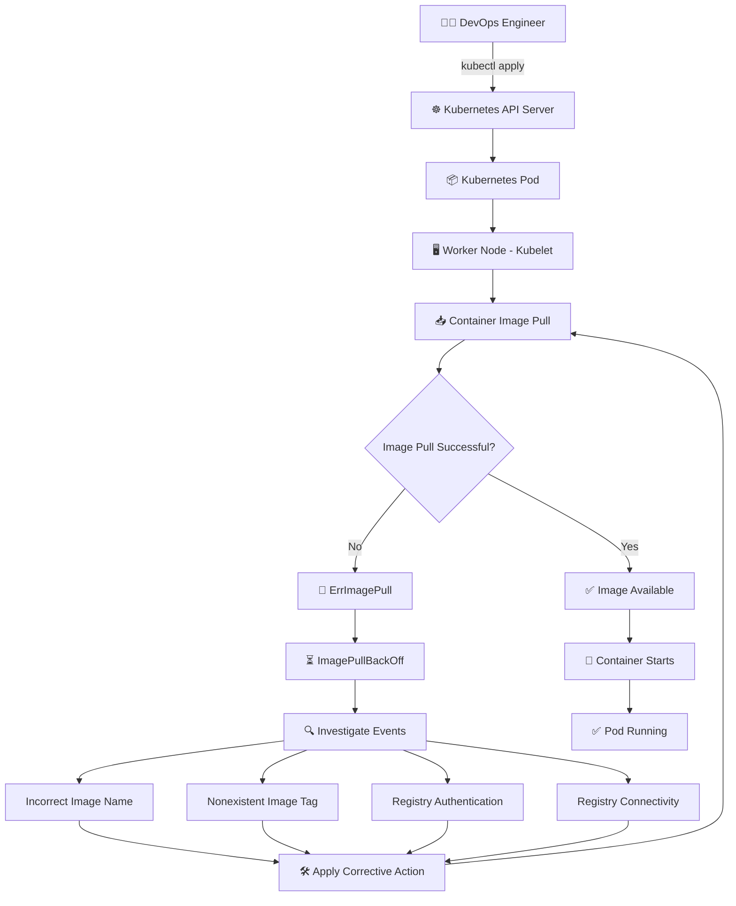
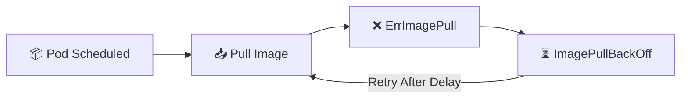
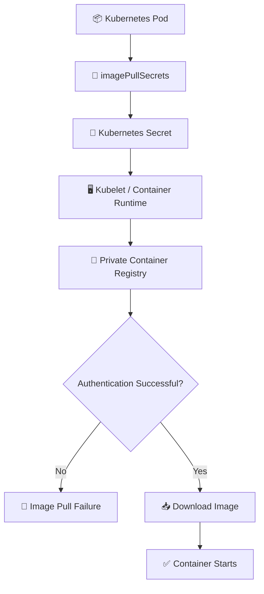
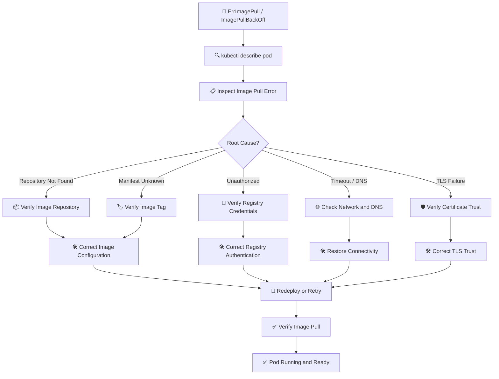

# ☸️ Kubernetes ImagePullBackOff and ErrImagePull Troubleshooting — Hands-On Lab

**Vyomanant Academy | Kubernetes Production Troubleshooting Series**

Learn how to identify, investigate, and resolve Kubernetes container image pull failures using practical, real-world troubleshooting scenarios.

| Lab Information | Details |
|---|---|
| 🎯 Skill Level | Beginner to Intermediate |
| ⏱️ Estimated Duration | 45–60 Minutes |
| 🛠️ Technologies | Kubernetes, kubectl, Docker Images, Container Registries |
| 🧪 Lab Environment | Minikube, Kind, or Kubernetes Cluster |
| 🏢 Lab Type | Instructor-Led + Self-Paced |
| 📚 Category | Kubernetes Production Troubleshooting |
| 🔢 Lab Number | 0003 |

---

# 🌍 Lab Overview

When Kubernetes creates a Pod, the kubelet must ensure that the required container image is available on the selected node.

If the image is not locally available, Kubernetes may need to download it from a container registry.

Sometimes this process fails.

Two common errors are:

- 🔴 `ErrImagePull`
- 🔴 `ImagePullBackOff`

These errors prevent containers from starting successfully.

### 🧠 What Is ErrImagePull?

`ErrImagePull` indicates that Kubernetes encountered an error while attempting to retrieve a container image.

Common causes include:

- Incorrect image name
- Nonexistent image tag
- Missing registry credentials
- Repository access restrictions
- Registry connectivity problems

### 🧠 What Is ImagePullBackOff?

`ImagePullBackOff` indicates that Kubernetes has failed to retrieve the image and is delaying subsequent retry attempts.

The delay increases between retries, up to a maximum backoff delay of approximately five minutes.

### 🔍 ErrImagePull vs. ImagePullBackOff

| ErrImagePull | ImagePullBackOff |
|---|---|
| Image pull attempt failed | Image pull retries are delayed |
| Indicates an image retrieval error | Indicates retry backoff after failures |
| Often observed during an initial failure | Commonly appears after repeated failures |
| Investigate detailed Pod events | Investigate the original pull failure |

> 💡 These are container waiting reasons displayed by `kubectl`, not Kubernetes Pod phases. The affected Pod commonly remains in the `Pending` phase.

# 🧪 Troubleshooting Scenarios

| Scenario | Problem | Learning Outcome |
|---|---|---|
| 🔴 1 | Incorrect container image name | Diagnose repository errors |
| 🔴 2 | Nonexistent image tag | Troubleshoot image versions |
| 🔴 3 | Missing image pull Secret | Diagnose registry authentication configuration |
| 🟡 4 | Registry connectivity problems | Investigate infrastructure dependencies |

You will intentionally create image pull failures, examine Kubernetes events, apply fixes, and verify recovery.

> ⚠️ **Important:** Perform this lab in a dedicated training cluster. The examples deliberately deploy Pods with incorrect image configurations.

---

# 🎯 Learning Objectives

After completing this lab, you will be able to:

- ✅ Understand how Kubernetes retrieves container images.
- ✅ Differentiate between ErrImagePull and ImagePullBackOff.
- ✅ Identify incorrect image repository names.
- ✅ Troubleshoot nonexistent image tags.
- ✅ Inspect image pull failure events.
- ✅ Understand imagePullSecrets.
- ✅ Diagnose missing registry credentials.
- ✅ Understand registry connectivity problems.
- ✅ Correct container image configurations.
- ✅ Verify successful image downloads and Pod recovery.

---

# 🧰 Prerequisites

| Requirement | Description |
|---|---|
| Kubernetes Cluster | Minikube, Kind, or managed Kubernetes |
| kubectl CLI | Installed and configured |
| Cluster Permissions | Create Pods, Secrets, and namespaces |
| Internet Connectivity | Worker nodes can access public container registries |
| YAML Knowledge | Basic Kubernetes manifests |
| Linux Terminal | Bash-compatible shell |

### Optional Requirements

For an actual private registry authentication exercise:

- Access to a private container registry
- Registry credentials with image pull permissions
- An existing private container image

The core exercises do not require a private registry account.

# Step 1 — Verify Kubernetes Connectivity

```bash
kubectl cluster-info
```

# Step 2 — Verify Kubernetes Nodes

```bash
kubectl get nodes
```

Expected: At least one eligible node should have the `Ready` status.

# Step 3 — Create a Dedicated Namespace

```bash
kubectl create namespace imagepull-lab
```

# Step 4 — Set the Default Namespace

```bash
kubectl config set-context --current --namespace=imagepull-lab
```

> ⚠️ This updates the namespace of your current kubectl context. Confirm that you are using the correct training cluster.

# Step 5 — Verify Namespace Configuration

```bash
kubectl get pods
```

Expected:

```text
No resources found in imagepull-lab namespace.
```

✅ **Lab Environment Ready**

---

# 🏗️ Lab Architecture



### 🧠 Kubernetes Container Image Pull Process

When a Pod is scheduled to a node:

1. The kubelet processes the Pod specification.
2. The container runtime checks the image requirements.
3. Kubernetes applies the configured `imagePullPolicy`.
4. If needed, the runtime contacts the container registry.
5. The registry returns the requested image layers.
6. The runtime prepares the container filesystem.
7. The container starts.

If the image cannot be downloaded, the container cannot start.

### Image Pull Failure Lifecycle



> 💡 Kubernetes may repeat image pull attempts automatically. However, retries alone cannot resolve an incorrect image name, nonexistent tag, or invalid registry credentials.

---

# 🚀 Step-by-Step Instructions

# 🔴 Scenario 1 — ErrImagePull Due to Incorrect Image Name

# 🎯 Objective

Understand how an incorrect container image repository causes Kubernetes image pull failures.

# Step 1 — Create a Pod with an Incorrect Image

Create a manifest:

```bash
nano wrong-image.yaml
```

Add:

```yaml
apiVersion: v1
kind: Pod
metadata:
  name: wrong-image
spec:
  containers:
  - name: nginx
    image: nginx-this-image-does-not-exist:v1
    imagePullPolicy: Always
    ports:
    - containerPort: 80
```

### 🧠 Explanation

The container image is configured as:

```text
nginx-this-image-does-not-exist:v1
```

This repository is intentionally invalid for the lab.

The kubelet attempts to retrieve the image from the default container registry.

Because the image is unavailable, the pull fails.

`imagePullPolicy: Always` ensures Kubernetes attempts image resolution through the registry when starting the container.

# Step 2 — Deploy the Pod

```bash
kubectl apply -f wrong-image.yaml
```

# Step 3 — Check Pod Status

```bash
kubectl get pods
```

Possible initial output:

```text
NAME          READY   STATUS         RESTARTS   AGE
wrong-image   0/1     ErrImagePull   0          10s
```

After retries:

```text
NAME          READY   STATUS             RESTARTS   AGE
wrong-image   0/1     ImagePullBackOff   0          40s
```

> 💡 The exact status depends on when you execute the command. Both ErrImagePull and ImagePullBackOff may appear during the same failure.

# Step 4 — Inspect Pod Details

```bash
kubectl describe pod wrong-image
```

Look for messages similar to:

```text
Failed to pull image "nginx-this-image-does-not-exist:v1"
```

```text
Error response from daemon: pull access denied
```

Or:

```text
repository does not exist or may require authorization
```

Depending on the container runtime, the exact message may differ.

# Step 5 — Inspect Kubernetes Events

```bash
kubectl get events --sort-by=.metadata.creationTimestamp
```

Look for:

```text
Failed
ErrImagePull
BackOff
ImagePullBackOff
```

### 🔍 Root Cause

The requested image repository does not exist or is not accessible.

# Step 6 — Fix the Image Name

Edit the manifest:

```bash
nano wrong-image.yaml
```

Replace it with:

```yaml
apiVersion: v1
kind: Pod
metadata:
  name: wrong-image
spec:
  containers:
  - name: nginx
    image: nginx:stable
    imagePullPolicy: Always
    ports:
    - containerPort: 80
```

### 🧠 Explanation

The corrected image is:

```text
nginx:stable
```

This references the official NGINX image on Docker Hub.

# Step 7 — Recreate the Pod

For this lab, delete and recreate the standalone Pod.

```bash
kubectl delete pod wrong-image
```

```bash
kubectl apply -f wrong-image.yaml
```

# Step 8 — Verify Recovery

```bash
kubectl get pods
```

Expected:

```text
NAME          READY   STATUS    RESTARTS   AGE
wrong-image   1/1     Running   0          30s
```

Verify the image:

```bash
kubectl describe pod wrong-image
```

Look for:

```text
Image: nginx:stable
```

And events similar to:

```text
Pulled
Created
Started
```

✅ **Scenario 1 Completed Successfully**

---

# 🔴 Scenario 2 — ImagePullBackOff Due to Nonexistent Image Tag

# 🎯 Objective

Understand how specifying an unavailable container image tag prevents Kubernetes from starting a Pod.

# 🧠 Understanding Container Image Tags

Container images are commonly identified using:

```text
repository:tag
```

Example:

```text
nginx:stable
```

Where:

- `nginx` is the repository name.
- `stable` is the image tag.

A tag identifies a particular image reference within a repository.

If the requested tag does not exist, Kubernetes cannot retrieve the image.

# Step 1 — Create a Pod with an Invalid Image Tag

Create the manifest:

```bash
nano wrong-tag.yaml
```

Add:

```yaml
apiVersion: v1
kind: Pod
metadata:
  name: wrong-tag
spec:
  containers:
  - name: nginx
    image: nginx:version-does-not-exist-99999
    imagePullPolicy: Always
    ports:
    - containerPort: 80
```

### 🧠 Explanation

The repository `nginx` is valid.

However, the requested tag is intentionally unavailable:

```text
version-does-not-exist-99999
```

Kubernetes attempts to pull the image but cannot find the requested version.

# Step 2 — Deploy the Pod

```bash
kubectl apply -f wrong-tag.yaml
```

# Step 3 — Check Pod Status

```bash
kubectl get pods
```

Expected after failed pull attempts:

```text
NAME        READY   STATUS             RESTARTS   AGE
wrong-tag   0/1     ImagePullBackOff   0          40s
```

# Step 4 — Inspect Pod Events

```bash
kubectl describe pod wrong-tag
```

Look for messages similar to:

```text
Failed to pull image "nginx:version-does-not-exist-99999"
```

```text
manifest unknown
```

Or:

```text
not found
```

### 🔍 Root Cause

The container image repository exists, but the specified tag cannot be found.

# Step 5 — Fix the Image Tag

Edit:

```bash
nano wrong-tag.yaml
```

Replace the manifest:

```yaml
apiVersion: v1
kind: Pod
metadata:
  name: wrong-tag
spec:
  containers:
  - name: nginx
    image: nginx:stable
    imagePullPolicy: Always
    ports:
    - containerPort: 80
```

# Step 6 — Recreate the Pod

```bash
kubectl delete pod wrong-tag
```

```bash
kubectl apply -f wrong-tag.yaml
```

# Step 7 — Verify Recovery

```bash
kubectl get pods
```

Expected:

```text
NAME        READY   STATUS    RESTARTS   AGE
wrong-tag   1/1     Running   0          30s
```

Check the container image:

```bash
kubectl get pod wrong-tag -o jsonpath='{.spec.containers[0].image}'
```

Expected:

```text
nginx:stable
```

✅ **Scenario 2 Completed Successfully**

### 🏢 Production Best Practice

Avoid relying on mutable image tags for production deployments when reproducibility is important.

Prefer:

- Verified application image versions
- Immutable image tags
- Image digests for precise image identification
- Image references maintained in version control
- Automated validation in CI/CD pipelines

For example, production deployments can use image digests:

```text
registry.example.com/my-application@sha256:<verified-digest>
```

> ⚠️ Replace `<verified-digest>` with a real image digest obtained from your image registry. This is an illustrative reference, not a deployable image.

---

# 🔴 Scenario 3 — Image Pull Failure Due to Missing Registry Credentials

# 🎯 Objective

Understand how Kubernetes uses imagePullSecrets to authenticate with private container registries.

# 🧠 Understanding Private Container Registries

Organizations frequently store container images in private registries.

Examples include:

- Docker Hub private repositories
- Amazon Elastic Container Registry (Amazon ECR)
- Azure Container Registry (ACR)
- Google Artifact Registry
- Harbor
- GitHub Container Registry (GHCR)

Private registries often require authentication before images can be downloaded.

Kubernetes can provide registry credentials using imagePullSecrets.

### Private Registry Authentication Architecture



# Step 1 — Create a Pod Referencing a Missing Image Pull Secret

Create the manifest:

```bash
nano missing-pull-secret.yaml
```

Add:

```yaml
apiVersion: v1
kind: Pod
metadata:
  name: missing-pull-secret
spec:
  containers:
  - name: nginx
    image: nginx:stable
    imagePullPolicy: Always
  imagePullSecrets:
  - name: registry-credentials
```

### 🧠 Explanation

The Pod references an image pull Secret named:

```text
registry-credentials
```

However, this Secret has not been created.

The Pod's image is public, so this scenario is designed to demonstrate how Kubernetes reports a missing pull Secret—not to guarantee an authentication failure.

> ⚠️ **Important:** A missing imagePullSecret does not always cause ImagePullBackOff. Kubernetes may still successfully download a public image without credentials.

# Step 2 — Deploy the Pod

```bash
kubectl apply -f missing-pull-secret.yaml
```

# Step 3 — Inspect Pod Events

```bash
kubectl describe pod missing-pull-secret
```

Look for an event similar to:

```text
FailedToRetrieveImagePullSecret
```

Example:

```text
Unable to retrieve some image pull secrets (registry-credentials)
```

The container may still start because `nginx:stable` is publicly accessible.

# Step 4 — Verify the Missing Secret

```bash
kubectl get secrets
```

Check the specific Secret:

```bash
kubectl get secret registry-credentials
```

Expected:

```text
Error from server (NotFound):
secrets "registry-credentials" not found
```

### 🔍 Root Cause

The Pod references an imagePullSecret that does not exist in its namespace.

For a genuine private image, unavailable or incorrect credentials can prevent image retrieval.

# Step 5 — Understand the Correct Production Solution

In production, configure valid registry credentials.

Kubernetes supports Secrets of type:

```text
kubernetes.io/dockerconfigjson
```

A common creation command is:

```bash
kubectl create secret docker-registry registry-credentials \
  --docker-server=<REGISTRY_SERVER> \
  --docker-username=<USERNAME> \
  --docker-password=<ACCESS_TOKEN> \
  --docker-email=<EMAIL>
```

### 🧠 Command Explanation

| Parameter | Purpose |
|---|---|
| `registry-credentials` | Kubernetes Secret name |
| `--docker-server` | Registry address |
| `--docker-username` | Registry username |
| `--docker-password` | Registry token or password |
| `--docker-email` | Optional legacy registry metadata |

> ⚠️ **Do not execute the example with placeholder values.** It requires real registry credentials and is included to demonstrate the configuration method. Passing credentials directly on the command line can expose them in shell history or process information.

### 🔐 Recommended Alternative

If Docker CLI credentials have already been configured, you can create the Kubernetes Secret from a compatible Docker configuration file.

```bash
kubectl create secret generic registry-credentials \
  --from-file=.dockerconfigjson=$HOME/.docker/config.json \
  --type=kubernetes.io/dockerconfigjson
```

> ⚠️ This assumes `$HOME/.docker/config.json` exists and contains usable authentication entries. Docker configurations that rely on an external credential store may not contain credentials suitable for direct import.

# Step 6 — Verify the Secret

After creating a valid Secret, run:

```bash
kubectl get secret registry-credentials
```

Check its type:

```bash
kubectl describe secret registry-credentials
```

Expected Secret type:

```text
kubernetes.io/dockerconfigjson
```

**Security note:** Do not print decoded Secret contents or commit registry credentials to GitHub.

# Step 7 — Fix the Training Pod

Because this lab uses the public NGINX image, no authentication Secret is required.

Edit:

```bash
nano missing-pull-secret.yaml
```

Replace the manifest:

```yaml
apiVersion: v1
kind: Pod
metadata:
  name: missing-pull-secret
spec:
  containers:
  - name: nginx
    image: nginx:stable
    imagePullPolicy: Always
```

The unnecessary imagePullSecrets reference has been removed.

# Step 8 — Recreate the Pod

```bash
kubectl delete pod missing-pull-secret
```

```bash
kubectl apply -f missing-pull-secret.yaml
```

# Step 9 — Verify Recovery

```bash
kubectl get pod missing-pull-secret
```

Expected:

```text
NAME                  READY   STATUS    RESTARTS   AGE
missing-pull-secret   1/1     Running   0          30s
```

Check recent Pod events:

```bash
kubectl describe pod missing-pull-secret
```

Verify that image retrieval succeeds.

✅ **Scenario 3 Completed Successfully**

### 🏢 Production Best Practices

When accessing private registries:

- Use properly scoped registry credentials.
- Create image pull Secrets in the same namespace as the Pod.
- Avoid hardcoding passwords in manifests.
- Use short-lived credentials where supported.
- Rotate registry credentials according to organizational policy.
- Prefer workload or node identity-based registry authentication where supported.
- For Amazon ECR on EKS, evaluate supported node or kubelet credential-provider integrations instead of assuming a manually created Docker registry Secret is required.

---

# 🟡 Scenario 4 — Container Registry Connectivity Troubleshooting

# 🎯 Objective

Understand how network, DNS, TLS, or registry availability issues affect Kubernetes image pulls.

This is an investigation exercise rather than a deliberate network outage.

No cluster networking configuration will be modified.

# 🧠 Why Registry Connectivity Matters

Kubernetes worker nodes must be able to reach the container registry when downloading an image.

Potential infrastructure problems include:

- DNS resolution failures
- Firewall restrictions
- Proxy misconfiguration
- Registry outages
- TLS certificate validation errors
- Restricted internet egress
- Registry rate limiting

# Step 1 — Inspect Kubernetes Nodes

```bash
kubectl get nodes -o wide
```

Check whether the nodes are Ready.

# Step 2 — Review Pod Events

```bash
kubectl describe pod wrong-image
```

For an affected production Pod, substitute its actual name.

Look for errors such as:

```text
i/o timeout
```

```text
no such host
```

```text
connection refused
```

```text
x509: certificate signed by unknown authority
```

These errors point to different failure categories.

# Step 3 — Understand Common Registry Errors

| Error | Possible Cause | Investigation |
|---|---|---|
| `i/o timeout` | Network connectivity issue | Check routing, firewall, proxy |
| `no such host` | DNS resolution failure | Inspect node DNS configuration |
| `connection refused` | Registry service or endpoint problem | Check endpoint and connectivity |
| `x509: certificate signed by unknown authority` | TLS trust issue | Inspect CA certificates and registry TLS |
| `unauthorized` | Registry authentication failure | Verify credentials and permissions |
| `manifest unknown` | Image tag or manifest missing | Verify repository and tag |
| `too many requests` | Registry rate limiting | Review registry usage and limits |

# Step 4 — Check Registry Connectivity from the Relevant Environment

If you have permission to access the affected worker node, investigate registry connectivity from that node.

Example Linux commands:

```bash
nslookup registry-1.docker.io
```

```bash
curl -I https://registry-1.docker.io/v2/
```

### 🧠 Explanation

`nslookup` checks DNS resolution.

`curl` checks whether an HTTPS connection can reach the registry endpoint.

> 💡 An HTTP `401 Unauthorized` response from the Docker Hub Registry API endpoint can be normal. It indicates that the endpoint is reachable but requires authentication for the requested API interaction.

> ⚠️ Running these commands on your laptop does not prove that the Kubernetes worker node has the same connectivity. For managed Kubernetes, use an approved node diagnostic method. A successful test from a debug Pod may also differ from the host's container runtime network path.

# Step 5 — Verify Container Registry Availability

If registry connectivity is suspected:

1. Check whether the registry endpoint is correct.
2. Verify worker-node DNS resolution.
3. Confirm outbound HTTPS access on TCP port 443.
4. Check proxy and firewall policies.
5. Verify registry credentials.
6. Review registry service status.
7. Inspect relevant kubelet and container runtime diagnostics.

> ⚠️ Do not disable TLS certificate verification as a production workaround. Correct the certificate trust configuration instead.

✅ **Scenario 4 Investigation Completed**

---

# 🔎 Verification

# Step 1 — Verify All Lab Pods

```bash
kubectl get pods
```

Expected:

```text
NAME                  READY   STATUS    RESTARTS   AGE
wrong-image           1/1     Running   0          5m
wrong-tag             1/1     Running   0          4m
missing-pull-secret   1/1     Running   0          3m
```

# Step 2 — Verify Container Images

```bash
kubectl get pods -o wide
```

Inspect one Pod:

```bash
kubectl describe pod wrong-image
```

Confirm:

```text
Image: nginx:stable
```

# Step 3 — Verify Pod Readiness

```bash
kubectl wait --for=condition=Ready pod/wrong-image --timeout=120s
```

```bash
kubectl wait --for=condition=Ready pod/wrong-tag --timeout=120s
```

```bash
kubectl wait --for=condition=Ready pod/missing-pull-secret --timeout=120s
```

Expected:

```text
pod/wrong-image condition met
```

Equivalent messages should appear for the remaining Pods.

# Step 4 — Review Namespace Events

```bash
kubectl get events --sort-by=.metadata.creationTimestamp
```

Older image pull failure events may remain temporarily.

Confirm that the corrected Pods are no longer generating new image pull failures.

# Step 5 — Inspect Container Waiting Reasons

```bash
kubectl get pods -o jsonpath='{range .items[*]}{.metadata.name}{"\t"}{range .status.containerStatuses[*]}{.state.waiting.reason}{"\t"}{end}{"\n"}{end}'
```

### 🧠 Explanation

This command displays:

- Pod names
- Container waiting reasons, when present

For healthy running containers, the waiting reason is typically empty.

✅ **Final Verification Completed**

---

# 🛠️ Image Pull Troubleshooting Command Reference

| Command | Purpose |
|---|---|
| `kubectl get pods` | Identify image pull failures |
| `kubectl describe pod <pod-name>` | Inspect image pull events |
| `kubectl get events` | Review Kubernetes events |
| `kubectl get pod <pod-name> -o yaml` | Inspect image configuration |
| `kubectl get secrets` | Identify available Secrets |
| `kubectl describe secret <secret-name>` | Inspect Secret metadata and type |
| `kubectl get nodes -o wide` | Inspect worker nodes |
| `kubectl wait --for=condition=Ready pod/<pod-name> --timeout=120s` | Verify Pod readiness |

> 💡 Container logs are generally unavailable when image retrieval fails before the container starts. Pod events are usually the most valuable initial diagnostic source.

---

# 🧭 Production Troubleshooting Workflow



### Production Troubleshooting Checklist

- [ ] Check the actual image repository.
- [ ] Verify the image tag or digest exists.
- [ ] Confirm the registry hostname.
- [ ] Inspect Pod image pull events.
- [ ] Check whether registry authentication is required.
- [ ] Verify imagePullSecrets exist in the correct namespace.
- [ ] Confirm registry credentials have image pull permissions.
- [ ] Check worker-node registry connectivity.
- [ ] Investigate TLS certificate errors.
- [ ] Check registry rate limits.
- [ ] Verify successful image retrieval.
- [ ] Confirm the Pod becomes Running and Ready.

---

# 🧹 Cleanup

# Step 1 — Delete the Lab Namespace

```bash
kubectl delete namespace imagepull-lab
```

This removes the lab Pods and namespace-scoped resources, including any Secrets created during the exercise.

# Step 2 — Verify Namespace Deletion

```bash
kubectl get namespace imagepull-lab
```

Expected after deletion completes:

```text
Error from server (NotFound):
namespaces "imagepull-lab" not found
```

# Step 3 — Restore the Default Namespace

```bash
kubectl config set-context --current --namespace=default
```

# Step 4 — Delete Local Manifest Files (Optional)

```bash
rm -f wrong-image.yaml wrong-tag.yaml missing-pull-secret.yaml
```

> ⚠️ Delete these files only if you no longer need them.

✅ **Cleanup Completed**

---

# 🧠 Key Takeaways

- ✅ ErrImagePull indicates that a container image pull attempt failed.
- ✅ ImagePullBackOff indicates Kubernetes is delaying subsequent image pull retries.
- ✅ Incorrect image repository names are a common cause of image pull failures.
- ✅ Nonexistent image tags prevent successful container image retrieval.
- ✅ Private registries may require authentication through imagePullSecrets or supported registry credential integrations.
- ✅ Missing imagePullSecrets do not necessarily prevent pulling publicly accessible images.
- ✅ Registry connectivity, DNS, TLS, and rate limits can affect image retrieval.
- ✅ Pod events are the primary starting point for image pull troubleshooting.
- ✅ Image pull failures occur before the affected application container starts.
- ✅ Production workloads should use verified image references and secure registry authentication.

---

# 🎓 Practical Assessment

Complete the following tasks without referring to the lab instructions.

- [ ] Create a Pod with an incorrect image repository.
- [ ] Identify ErrImagePull using kubectl.
- [ ] Observe ImagePullBackOff after repeated pull failures.
- [ ] Identify the actual image pull error from Pod events.
- [ ] Correct the invalid image repository.
- [ ] Create a Pod with a nonexistent image tag.
- [ ] Identify a manifest-not-found error.
- [ ] Correct the image tag.
- [ ] Create a Pod referencing a nonexistent imagePullSecret.
- [ ] Identify FailedToRetrieveImagePullSecret events.
- [ ] Explain why public images may still pull successfully.
- [ ] Explain how private registry authentication works.
- [ ] Identify common DNS, TLS, and network image pull errors.
- [ ] Verify all corrected Pods are Running and Ready.

---

# 📚 Official Documentation

| Resource | Official Documentation |
|---|---|
| Kubernetes Container Images | [Kubernetes Docs](https://kubernetes.io/docs/concepts/containers/images/) |
| Pull an Image from a Private Registry | [Kubernetes Docs](https://kubernetes.io/docs/tasks/configure-pod-container/pull-image-private-registry/) |
| Debug Running Pods | [Kubernetes Docs](https://kubernetes.io/docs/tasks/debug/debug-application/debug-running-pod/) |
| Kubernetes Secrets | [Kubernetes Docs](https://kubernetes.io/docs/concepts/configuration/secret/) |
| Kubernetes Pod Lifecycle | [Kubernetes Docs](https://kubernetes.io/docs/concepts/workloads/pods/pod-lifecycle/) |
| Kubernetes kubectl Reference | [Kubernetes Docs](https://kubernetes.io/docs/reference/kubectl/) |
| GitHub Mermaid Diagrams | [GitHub Docs](https://docs.github.com/en/get-started/writing-on-github/working-with-advanced-formatting/creating-diagrams) |

---

**🎓 Vyomanant Academy — Learn • Practice • Troubleshoot • Validate**

**✅ Lab 0003 Complete**

**➡️ Next Lab: 0004 — Kubernetes OOMKilled and Memory Resource Troubleshooting**
