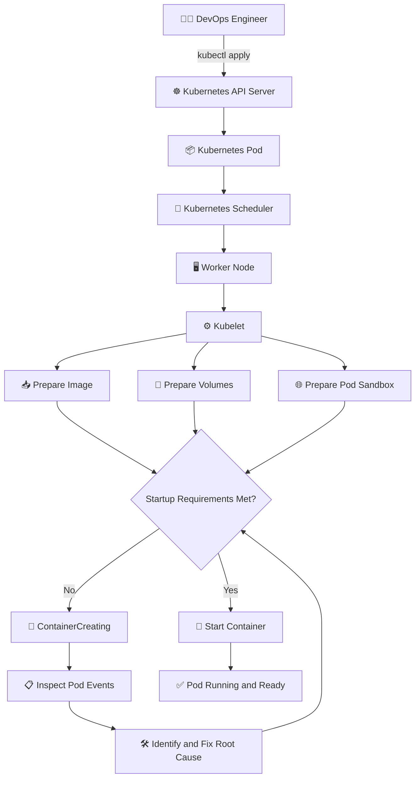
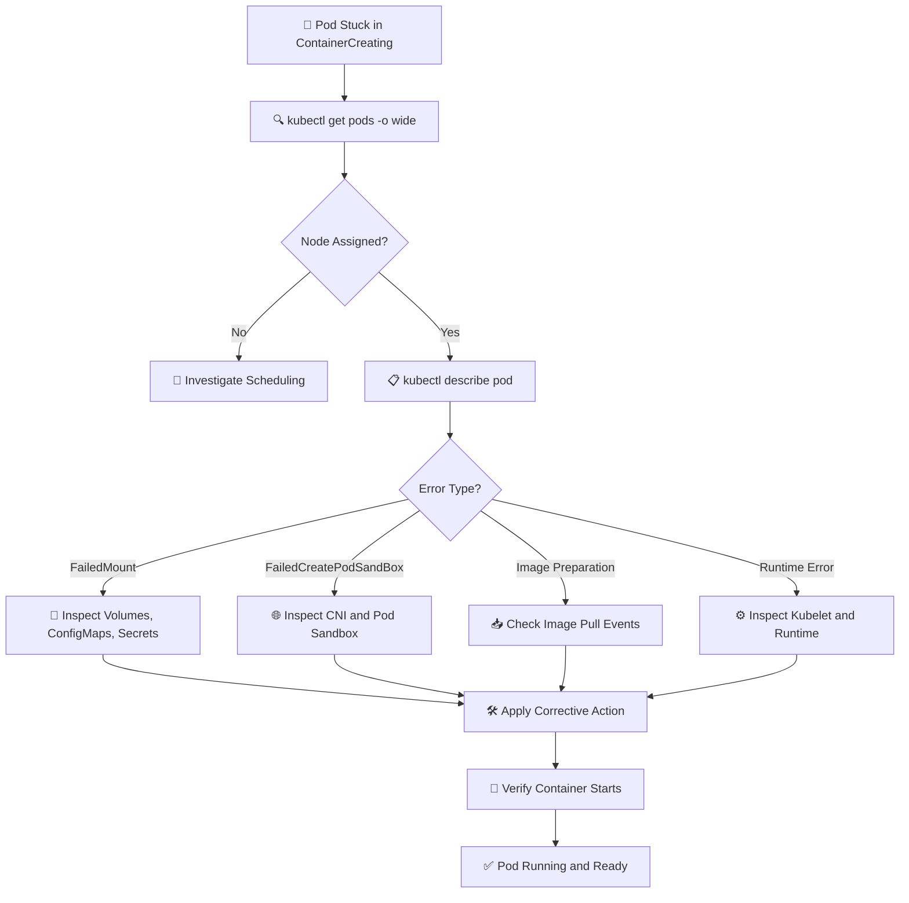

# ☸️ Kubernetes Pod Stuck in ContainerCreating — Hands-On Troubleshooting Lab

**Vyomanant Academy | Kubernetes Production Troubleshooting Series**

Learn how to diagnose and resolve Kubernetes Pods stuck in `ContainerCreating` using practical troubleshooting scenarios involving ConfigMaps, Secrets, volume mounts, and container startup dependencies.

| Lab Information | Details |
|---|---|
| 🎯 Skill Level | Beginner to Intermediate |
| ⏱️ Duration | 45–60 Minutes |
| 🛠️ Technologies | Kubernetes, kubectl, Linux, ConfigMaps, Secrets |
| 🧪 Environment | Minikube, Kind, or Kubernetes Cluster |
| 🏢 Lab Type | Instructor-Led + Self-Paced |
| 📚 Category | Kubernetes Production Troubleshooting |
| 🔢 Lab Number | 0004 |

---

# 🌍 Lab Overview

When Kubernetes creates a Pod, several operations must complete before its application containers can start.

These include:

- Scheduling the Pod onto a node
- Preparing the Pod sandbox and networking
- Preparing container images
- Setting up storage volumes
- Mounting ConfigMaps and Secrets
- Creating application containers

During this process, `kubectl get pods` may display:

```text
NAME      READY   STATUS              RESTARTS   AGE
app-pod   0/1     ContainerCreating   0          30s
```

Normally, `ContainerCreating` is temporary.

However, a Pod may remain in this state when Kubernetes cannot complete an operation required to start the container.

### 🧠 What Is ContainerCreating?

`ContainerCreating` is a container waiting reason commonly displayed while the kubelet prepares a container.

It is **not a Kubernetes Pod phase**.

The Pod typically remains in the `Pending` phase until container startup progresses.

### 🔍 Common Causes

| Root Cause | Description |
|---|---|
| Missing ConfigMap | Required ConfigMap volume cannot be mounted |
| Missing Secret | Required Secret volume cannot be mounted |
| Invalid ConfigMap key | Referenced configuration key does not exist |
| Storage mount failure | Kubernetes cannot prepare or mount a volume |
| CNI networking issue | Pod sandbox networking cannot be configured |
| Container runtime issue | Runtime cannot create the Pod sandbox or container |
| Image preparation delay | Container image downloading or unpacking takes time |

> ⚠️ An image pull failure may eventually display `ErrImagePull` or `ImagePullBackOff` instead. Those conditions are covered in Lab 0003.

# 🧪 Lab Scenarios

| Scenario | Problem | Learning Outcome |
|---|---|---|
| 🔴 1 | Missing ConfigMap | Troubleshoot FailedMount events |
| 🔴 2 | Missing Secret | Resolve Secret volume dependencies |
| 🔴 3 | Missing ConfigMap key | Diagnose incorrect volume configuration |
| 🟡 4 | Pod sandbox or runtime issues | Investigate node-level startup failures |

In the first three scenarios, you will deliberately create configuration problems and then correct them.

The fourth scenario is a guided production investigation.

---

# 🎯 Learning Objectives

After completing this lab, you will be able to:

- ✅ Understand what ContainerCreating means.
- ✅ Differentiate Pod phases from container waiting reasons.
- ✅ Identify containers waiting for startup dependencies.
- ✅ Investigate FailedMount events.
- ✅ Troubleshoot missing ConfigMaps and Secrets.
- ✅ Resolve invalid ConfigMap volume references.
- ✅ Understand the role of the kubelet and container runtime.
- ✅ Recognize Pod sandbox and networking failures.
- ✅ Verify successful container startup.
- ✅ Apply a structured production troubleshooting workflow.

---

# 🧰 Prerequisites

| Requirement | Description |
|---|---|
| Kubernetes Cluster | Minikube, Kind, or managed Kubernetes |
| kubectl | Installed and configured |
| Cluster Access | Permission to create Pods, ConfigMaps, Secrets, and namespaces |
| Container Image Access | Worker nodes can obtain BusyBox images |
| YAML Knowledge | Basic Kubernetes manifests |
| Linux Terminal | Bash-compatible shell |

### Recommended Environment

A single-node Minikube or Kind cluster is sufficient.

Use a dedicated training cluster where possible.

# Step 1 — Verify Cluster Connectivity

```bash
kubectl cluster-info
```

# Step 2 — Verify Nodes

```bash
kubectl get nodes
```

Expected:

```text
NAME           STATUS   ROLES           AGE   VERSION
minikube       Ready    control-plane   2d    v1.xx.x
```

Your node name and Kubernetes version may differ.

# Step 3 — Create a Dedicated Namespace

```bash
kubectl create namespace containercreating-lab
```

# Step 4 — Set the Default Namespace

```bash
kubectl config set-context --current --namespace=containercreating-lab
```

> ⚠️ This updates the namespace in your current kubectl context.

# Step 5 — Verify the Namespace

```bash
kubectl get pods
```

Expected:

```text
No resources found in containercreating-lab namespace.
```

✅ **Lab Environment Ready**

---

# 🏗️ Lab Architecture



### 🧠 Understanding the Container Startup Process

```text
Pod Created
    |
    v
Pod Scheduled to Node
    |
    v
Kubelet Receives Pod
    |
    v
Prepare Pod Sandbox
    |
    v
Prepare Container Image
    |
    v
Prepare and Mount Volumes
    |
    v
Create Application Container
    |
    v
Start Container
    |
    v
Pod Running
```

> 💡 These activities represent a simplified startup flow. Image preparation, sandbox setup, and volume operations are not guaranteed to execute in exactly this order.

---

# 🚀 Step-by-Step Instructions

# 🔴 Scenario 1 — ContainerCreating Due to Missing ConfigMap

# 🎯 Objective

Understand how a missing ConfigMap prevents Kubernetes from mounting required application configuration.

# 🧠 What Is a ConfigMap?

A ConfigMap stores non-sensitive application configuration as key-value data.

Applications can consume ConfigMaps as:

- Environment variables
- Configuration files
- Mounted volumes

When a required ConfigMap volume cannot be prepared, the application container may remain in `ContainerCreating`.

# Step 1 — Verify Existing ConfigMaps

```bash
kubectl get configmaps
```

The namespace may already contain a Kubernetes-managed ConfigMap such as `kube-root-ca.crt`.

For this lab, we will reference a ConfigMap that does not exist.

# Step 2 — Create a Pod Referencing a Missing ConfigMap

Create a manifest:

```bash
nano missing-configmap.yaml
```

Add:

```yaml
apiVersion: v1
kind: Pod
metadata:
  name: missing-configmap
spec:
  containers:
  - name: app
    image: busybox:1.36
    command: ["/bin/sh", "-c"]
    args:
      - |
        echo "Application started"
        sleep 3600
    volumeMounts:
    - name: app-config
      mountPath: /etc/app-config
  volumes:
  - name: app-config
    configMap:
      name: application-config
```

### 🧠 Explanation

The Pod requires a ConfigMap named:

```text
application-config
```

The ConfigMap is not present in the namespace.

Kubernetes cannot prepare the required volume.

# Step 3 — Deploy the Pod

```bash
kubectl apply -f missing-configmap.yaml
```

# Step 4 — Check Pod Status

```bash
kubectl get pods
```

Expected after scheduling:

```text
NAME                READY   STATUS              RESTARTS   AGE
missing-configmap   0/1     ContainerCreating   0          20s
```

The exact displayed state depends on timing.

# Step 5 — Inspect Pod Details

```bash
kubectl describe pod missing-configmap
```

Look for:

```text
State:          Waiting
  Reason:       ContainerCreating
```

In the Events section, look for an error similar to:

```text
Warning  FailedMount  kubelet
MountVolume.SetUp failed for volume "app-config":
configmap "application-config" not found
```

### 🔍 Root Cause

The container cannot start because the required ConfigMap volume cannot be mounted.

# Step 6 — Verify the Missing ConfigMap

```bash
kubectl get configmap application-config
```

Expected:

```text
Error from server (NotFound):
configmaps "application-config" not found
```

# Step 7 — Create the Missing ConfigMap

Create the required configuration:

```bash
kubectl create configmap application-config \
  --from-literal=APP_ENV=production \
  --from-literal=LOG_LEVEL=info
```

### 🧠 Explanation

This creates a ConfigMap containing:

```text
APP_ENV=production
LOG_LEVEL=info
```

# Step 8 — Verify the ConfigMap

```bash
kubectl get configmap application-config
```

Inspect its contents:

```bash
kubectl describe configmap application-config
```

# Step 9 — Verify Pod Recovery

Kubernetes should automatically retry the failed volume setup.

You normally do not need to delete the Pod after creating the missing ConfigMap.

```bash
kubectl get pods -w
```

Observe the Pod transitioning toward `Running`.

Press `Ctrl+C` to stop watching.

Expected:

```text
NAME                READY   STATUS    RESTARTS   AGE
missing-configmap   1/1     Running   0          2m
```

# Step 10 — Verify Mounted Configuration

```bash
kubectl exec missing-configmap -- ls /etc/app-config
```

Expected:

```text
APP_ENV
LOG_LEVEL
```

Read one configuration value:

```bash
kubectl exec missing-configmap -- cat /etc/app-config/APP_ENV
```

Expected:

```text
production
```

✅ **Scenario 1 Completed Successfully**

---

# 🔴 Scenario 2 — ContainerCreating Due to Missing Secret

# 🎯 Objective

Understand how a missing Kubernetes Secret prevents a required volume from being mounted.

# 🧠 What Is a Kubernetes Secret?

A Kubernetes Secret stores data such as:

- Application credentials
- API tokens
- Passwords
- TLS certificates
- Other sensitive configuration values

Applications can consume Secrets using environment variables or mounted volumes.

If a required Secret volume references a nonexistent Secret, container startup can be blocked.

> 🔐 Kubernetes Secrets are not automatically encrypted at rest in every cluster. Production environments should configure appropriate encryption, RBAC, and access controls.

# Step 1 — Check Existing Secrets

```bash
kubectl get secrets
```

# Step 2 — Create a Pod Referencing a Missing Secret

Create:

```bash
nano missing-secret.yaml
```

Add:

```yaml
apiVersion: v1
kind: Pod
metadata:
  name: missing-secret
spec:
  containers:
  - name: app
    image: busybox:1.36
    command: ["/bin/sh", "-c"]
    args:
      - |
        echo "Application started"
        sleep 3600
    volumeMounts:
    - name: credentials
      mountPath: /etc/credentials
      readOnly: true
  volumes:
  - name: credentials
    secret:
      secretName: application-secret
```

### 🧠 Explanation

The application requires:

```text
application-secret
```

This Secret does not exist.

The kubelet cannot prepare the required Secret volume.

# Step 3 — Deploy the Pod

```bash
kubectl apply -f missing-secret.yaml
```

# Step 4 — Check Pod Status

```bash
kubectl get pods
```

Expected:

```text
NAME             READY   STATUS              RESTARTS   AGE
missing-secret   0/1     ContainerCreating   0          30s
```

# Step 5 — Inspect Pod Events

```bash
kubectl describe pod missing-secret
```

Look for an event similar to:

```text
Warning  FailedMount  kubelet
MountVolume.SetUp failed for volume "credentials":
secret "application-secret" not found
```

# Step 6 — Verify the Missing Secret

```bash
kubectl get secret application-secret
```

Expected:

```text
Error from server (NotFound):
secrets "application-secret" not found
```

### 🔍 Root Cause

The Pod references a Secret volume that cannot be resolved.

# Step 7 — Create the Missing Secret

For this training environment, create a dummy Secret:

```bash
kubectl create secret generic application-secret \
  --from-literal=username=demo-user \
  --from-literal=password=demo-password
```

> ⚠️ These are dummy credentials for training only. Never use this example password for a real application.

# Step 8 — Verify the Secret

```bash
kubectl get secret application-secret
```

Inspect metadata:

```bash
kubectl describe secret application-secret
```

Expected Secret type:

```text
Opaque
```

# Step 9 — Verify Pod Recovery

```bash
kubectl get pods -w
```

After Kubernetes successfully prepares the Secret volume, the container should start.

Expected:

```text
NAME             READY   STATUS    RESTARTS   AGE
missing-secret   1/1     Running   0          2m
```

Press `Ctrl+C` to stop watching.

# Step 10 — Verify the Secret Volume Mount

List the mounted files:

```bash
kubectl exec missing-secret -- ls /etc/credentials
```

Expected:

```text
password
username
```

Do not print the password contents.

✅ **Scenario 2 Completed Successfully**

### 🏢 Production Best Practice

- Keep Secrets separate from application manifests.
- Grant access using least-privilege RBAC.
- Enable encryption at rest where appropriate.
- Avoid committing plaintext credentials to GitHub.
- Rotate credentials according to organizational policies.
- Consider approved external secret management solutions.

---

# 🔴 Scenario 3 — ContainerCreating Due to Missing ConfigMap Key

# 🎯 Objective

Learn how an incorrect key reference inside a ConfigMap volume can prevent a container from starting.

# 🧠 Understanding ConfigMap Volume Keys

Kubernetes allows you to select particular ConfigMap keys when creating a mounted volume.

Example:

```yaml
items:
- key: application.properties
  path: application.properties
```

The key must exist in the referenced ConfigMap unless the configuration permits it to be absent.

# Step 1 — Create a ConfigMap

```bash
kubectl create configmap webapp-config \
  --from-literal=app.properties=environment=production
```

# Step 2 — Verify the ConfigMap

```bash
kubectl describe configmap webapp-config
```

The ConfigMap contains:

```text
app.properties
```

# Step 3 — Create a Pod Referencing a Nonexistent Key

Create:

```bash
nano invalid-configmap-key.yaml
```

Add:

```yaml
apiVersion: v1
kind: Pod
metadata:
  name: invalid-configmap-key
spec:
  containers:
  - name: app
    image: busybox:1.36
    command: ["/bin/sh", "-c"]
    args:
      - |
        echo "Application started"
        sleep 3600
    volumeMounts:
    - name: webapp-config-volume
      mountPath: /etc/webapp
  volumes:
  - name: webapp-config-volume
    configMap:
      name: webapp-config
      items:
      - key: missing.properties
        path: application.properties
```

### 🧠 Explanation

The ConfigMap contains:

```text
app.properties
```

However, the Pod requests:

```text
missing.properties
```

The requested key does not exist.

# Step 4 — Deploy the Pod

```bash
kubectl apply -f invalid-configmap-key.yaml
```

# Step 5 — Check Pod Status

```bash
kubectl get pods
```

Expected:

```text
NAME                    READY   STATUS              RESTARTS   AGE
invalid-configmap-key   0/1     ContainerCreating   0          20s
```

# Step 6 — Inspect Pod Events

```bash
kubectl describe pod invalid-configmap-key
```

Look for a FailedMount event indicating that the requested ConfigMap key is missing.

Example:

```text
Warning  FailedMount  kubelet
MountVolume.SetUp failed for volume "webapp-config-volume"
```

The event may mention:

```text
references non-existent config key: missing.properties
```

### 🔍 Root Cause

The Pod requests a ConfigMap key that does not exist.

# Step 7 — Fix the Missing ConfigMap Key

For this scenario, add the required key to the existing ConfigMap.

```bash
kubectl patch configmap webapp-config \
  --type merge \
  -p '{"data":{"missing.properties":"environment=production"}}'
```

### 🧠 Explanation

This command adds the missing key:

```text
missing.properties
```

The existing `app.properties` key is preserved.

# Step 8 — Verify the Updated ConfigMap

```bash
kubectl describe configmap webapp-config
```

You should now see both keys.

# Step 9 — Verify Pod Recovery

```bash
kubectl get pods -w
```

Kubernetes should retry volume setup and start the container.

Expected:

```text
NAME                    READY   STATUS    RESTARTS   AGE
invalid-configmap-key   1/1     Running   0          2m
```

Press `Ctrl+C` to stop watching.

# Step 10 — Verify the Mounted File

```bash
kubectl exec invalid-configmap-key -- ls /etc/webapp
```

Expected:

```text
application.properties
```

Read the mounted file:

```bash
kubectl exec invalid-configmap-key -- cat /etc/webapp/application.properties
```

Expected:

```text
environment=production
```

✅ **Scenario 3 Completed Successfully**

### 🏢 Production Consideration

A more appropriate production fix may be to correct the key reference in the application workload manifest.

Choose the solution that matches the application's actual configuration contract.

Do not add arbitrary keys solely to suppress Kubernetes errors.

---

# 🟡 Scenario 4 — Pod Sandbox and Container Runtime Troubleshooting

# 🎯 Objective

Understand how infrastructure-level issues can prevent Kubernetes from completing container creation.

This scenario is an investigation exercise.

You will not intentionally damage cluster networking or stop the container runtime.

# 🧠 What Is a Pod Sandbox?

Before application containers can run, the container runtime prepares a Pod sandbox.

The sandbox provides the execution environment for the Pod, including network namespace preparation.

In many Linux Kubernetes environments, this involves a sandbox container and CNI-based networking.

Problems during sandbox preparation can prevent application containers from starting.

### Common Problems

| Problem | Potential Cause |
|---|---|
| FailedCreatePodSandBox | Sandbox creation failure |
| Failed to setup network | CNI networking problem |
| Network plugin not ready | CNI initialization failure |
| Container runtime unavailable | Runtime service problem |
| FailedMount | Storage or volume setup issue |
| Timeout preparing container | Node, runtime, or storage delays |

# Step 1 — Check All Pods

```bash
kubectl get pods -A
```

Look for Pods with:

```text
ContainerCreating
```

Check whether multiple workloads are affected.

# Step 2 — Inspect Kubernetes Nodes

```bash
kubectl get nodes -o wide
```

Verify node readiness.

# Step 3 — Inspect Pod Details

Use the name of an affected Pod:

```bash
kubectl describe pod <POD_NAME> -n <NAMESPACE>
```

Replace the placeholders with actual values.

Look for:

```text
FailedCreatePodSandBox
```

Or:

```text
Failed to setup network
```

# Step 4 — Review Cluster Events

```bash
kubectl get events -A --sort-by=.metadata.creationTimestamp
```

Investigate events associated with the affected Pod and node.

# Step 5 — Identify the Assigned Worker Node

```bash
kubectl get pod <POD_NAME> -n <NAMESPACE> -o wide
```

Check the `NODE` column.

If the Pod has not been assigned to a node, investigate scheduling rather than container creation.

# Step 6 — Investigate Kubelet Logs

If you have authorized SSH or console access to the affected Linux worker node, run:

```bash
sudo journalctl -u kubelet -n 100 --no-pager
```

Check for:

- Pod sandbox creation failures
- Volume mount errors
- CNI plugin errors
- Container runtime communication failures
- Node resource pressure

> ⚠️ This command runs on the Kubernetes worker node, not necessarily on your local workstation. Access to managed cluster nodes may be restricted.

# Step 7 — Inspect the Container Runtime

Kubernetes commonly uses containerd or another CRI-compatible runtime.

On a Linux node using containerd as a systemd service:

```bash
sudo systemctl status containerd
```

Inspect recent runtime logs:

```bash
sudo journalctl -u containerd -n 100 --no-pager
```

### 🧠 Explanation

These commands help determine whether the container runtime is running and reporting errors.

> ⚠️ Not all Kubernetes distributions manage containerd using a service named `containerd`. Check your runtime and distribution before using host-level commands.

# Step 8 — Inspect Disk Capacity

On the affected node:

```bash
df -h
```

Check inode utilization:

```bash
df -i
```

Insufficient disk space or inodes may prevent container creation and image unpacking.

# Step 9 — Verify Kubernetes Networking Components

```bash
kubectl get pods -n kube-system
```

Identify the networking components installed in your cluster.

Examples include:

- Calico
- Cilium
- Flannel
- Cloud-provider networking components

> 💡 The CNI implementation depends on your Kubernetes distribution. Not every cluster uses the same networking components or namespace layout.

# Step 10 — Apply the Appropriate Corrective Action

Based on the diagnosed root cause:

- Correct CNI configuration issues.
- Restore registry or image access.
- Resolve storage mount failures.
- Address disk or inode exhaustion.
- Restore unhealthy container runtime services through approved procedures.
- Investigate node-level failures.
- Follow your organization's change and incident procedures.

> ⚠️ Do not randomly restart kubelet, containerd, or networking components in production. Such actions can affect running workloads and make troubleshooting more difficult.

✅ **Scenario 4 Investigation Completed**

---

# 🔎 Verification

# Step 1 — Check All Lab Pods

```bash
kubectl get pods
```

Expected:

```text
NAME                    READY   STATUS    RESTARTS   AGE
missing-configmap       1/1     Running   0          10m
missing-secret          1/1     Running   0          8m
invalid-configmap-key   1/1     Running   0          5m
```

# Step 2 — Verify Pod Scheduling

```bash
kubectl get pods -o wide
```

All three Pods should have an assigned node.

# Step 3 — Verify Pod Readiness

```bash
kubectl wait --for=condition=Ready pod/missing-configmap --timeout=120s
```

```bash
kubectl wait --for=condition=Ready pod/missing-secret --timeout=120s
```

```bash
kubectl wait --for=condition=Ready pod/invalid-configmap-key --timeout=120s
```

Expected:

```text
pod/missing-configmap condition met
pod/missing-secret condition met
pod/invalid-configmap-key condition met
```

# Step 4 — Review Kubernetes Events

```bash
kubectl get events --sort-by=.metadata.creationTimestamp
```

Older FailedMount events may still appear.

Confirm that the Pods are no longer experiencing new mount failures.

# Step 5 — Verify Container Startup Status

```bash
kubectl get pods -o jsonpath='{range .items[*]}{.metadata.name}{"\t"}{range .status.containerStatuses[*]}{.state.waiting.reason}{"\t"}{end}{"\n"}{end}'
```

For running containers, the waiting reason should be empty.

✅ **Final Verification Completed**

---

# 🛠️ ContainerCreating Troubleshooting Command Reference

| Command | Purpose |
|---|---|
| `kubectl get pods` | Identify affected Pods |
| `kubectl get pods -o wide` | Check node assignment |
| `kubectl describe pod <pod-name>` | Inspect container states and events |
| `kubectl get events` | Review namespace events |
| `kubectl get configmaps` | Check available ConfigMaps |
| `kubectl get secrets` | Check Secret existence |
| `kubectl describe configmap <name>` | Inspect ConfigMap data and keys |
| `kubectl describe secret <name>` | Inspect Secret metadata |
| `kubectl get nodes -o wide` | Check node status |
| `kubectl get pods -n kube-system` | Inspect system components |
| `sudo journalctl -u kubelet -n 100 --no-pager` | Inspect node kubelet logs |
| `sudo systemctl status containerd` | Check containerd service where applicable |

### ⚠️ Why kubectl logs May Not Work

If the application container has never started, this command:

```bash
kubectl logs missing-configmap
```

May return an error similar to:

```text
container "app" in pod "missing-configmap" is waiting to start: ContainerCreating
```

This is expected when the container does not yet exist as a running or previously terminated instance with available logs.

**For ContainerCreating problems, start with Pod events and container state information.**

---

# 🧭 Production Troubleshooting Workflow



# 🔍 ContainerCreating vs. Related Kubernetes States

| Displayed STATUS | Meaning | Primary Investigation |
|---|---|---|
| Pending | Pod has not fully entered Running | Scheduler, dependencies, initialization |
| ContainerCreating | Container preparation is in progress | Volumes, sandbox, runtime, images |
| ErrImagePull | Image retrieval failed | Image name, tag, credentials |
| ImagePullBackOff | Image retries are delayed | Original image pull failure |
| CrashLoopBackOff | Container repeatedly fails after starting | Application logs, exit codes, probes |
| Running | Pod has at least one running container and is in Running phase | Readiness and application health |

> 💡 The `STATUS` column in `kubectl get pods` is a human-readable summary and may display container waiting reasons instead of the underlying Pod phase.

---

# 🧹 Cleanup

# Step 1 — Delete the Lab Namespace

```bash
kubectl delete namespace containercreating-lab
```

This removes the lab Pods, ConfigMaps, and Secrets.

# Step 2 — Verify Namespace Deletion

```bash
kubectl get namespace containercreating-lab
```

Expected after deletion completes:

```text
Error from server (NotFound):
namespaces "containercreating-lab" not found
```

# Step 3 — Restore the Default Namespace

```bash
kubectl config set-context --current --namespace=default
```

# Step 4 — Remove Local Manifest Files (Optional)

```bash
rm -f missing-configmap.yaml missing-secret.yaml invalid-configmap-key.yaml
```

> ⚠️ Execute this command only when the files are no longer needed.

✅ **Cleanup Completed**

---

# 🧠 Key Takeaways

- ✅ ContainerCreating is a container waiting reason, not a Pod phase.
- ✅ Kubernetes may display ContainerCreating while preparing container startup dependencies.
- ✅ Missing ConfigMap volumes can prevent containers from starting.
- ✅ Missing Secret volumes can result in FailedMount events.
- ✅ Invalid ConfigMap keys can block volume preparation.
- ✅ Kubernetes normally retries transient volume setup failures automatically.
- ✅ Pod events are the most useful initial diagnostic source.
- ✅ Container logs may be unavailable if the container has never started.
- ✅ Pod sandbox failures may indicate networking or container runtime issues.
- ✅ Production troubleshooting should prioritize root cause identification before disruptive remediation.

---

# 🎓 Practical Assessment

Complete the following tasks independently.

- [ ] Explain what ContainerCreating means.
- [ ] Create a Pod referencing a missing ConfigMap.
- [ ] Identify the FailedMount event.
- [ ] Create the missing ConfigMap.
- [ ] Verify successful Pod recovery.
- [ ] Create a Pod referencing a missing Secret.
- [ ] Diagnose the missing Secret dependency.
- [ ] Create the Secret and verify recovery.
- [ ] Create a ConfigMap with one configuration key.
- [ ] Deploy a Pod requesting a nonexistent key.
- [ ] Identify the incorrect key reference.
- [ ] Correct the configuration dependency.
- [ ] Explain why Pod logs may not be available.
- [ ] Identify Kubernetes node-level diagnostic commands.
- [ ] Verify all lab Pods are Running and Ready.

---

# 📚 Official Documentation

| Resource | Official Documentation |
|---|---|
| Kubernetes Pod Lifecycle | [Kubernetes Docs](https://kubernetes.io/docs/concepts/workloads/pods/pod-lifecycle/) |
| Debug Running Pods | [Kubernetes Docs](https://kubernetes.io/docs/tasks/debug/debug-application/debug-running-pod/) |
| Configure a Pod to Use a ConfigMap | [Kubernetes Docs](https://kubernetes.io/docs/tasks/configure-pod-container/configure-pod-configmap/) |
| Kubernetes Secrets | [Kubernetes Docs](https://kubernetes.io/docs/concepts/configuration/secret/) |
| Kubernetes Volumes | [Kubernetes Docs](https://kubernetes.io/docs/concepts/storage/volumes/) |
| Debugging Kubernetes Nodes | [Kubernetes Docs](https://kubernetes.io/docs/tasks/debug/debug-cluster/kubectl-node-debug/) |
| Container Runtime Interface | [Kubernetes Docs](https://kubernetes.io/docs/concepts/architecture/cri/) |
| Kubernetes Application Troubleshooting | [Kubernetes Docs](https://kubernetes.io/docs/tasks/debug/debug-application/) |
| GitHub Mermaid Diagrams | [GitHub Docs](https://docs.github.com/en/get-started/writing-on-github/working-with-advanced-formatting/creating-diagrams) |

---

**🎓 Vyomanant Academy — Learn • Practice • Troubleshoot • Validate**

**✅ Lab 0004 Complete**

**➡️ Next Lab: 0005 — Kubernetes OOMKilled and Memory Resource Troubleshooting**
